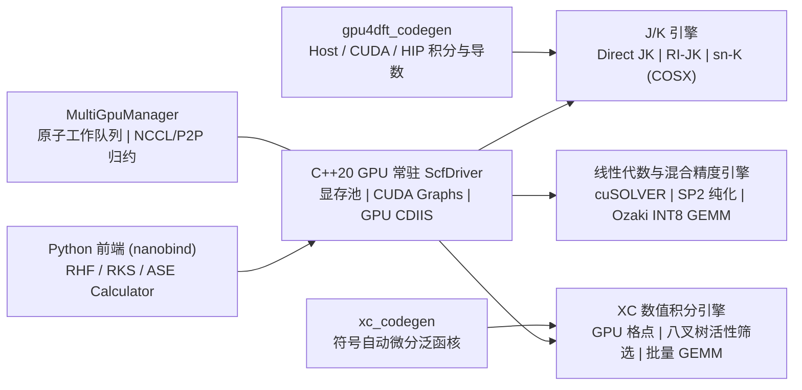

# GPU4DFT

**GPU4DFT** 是一个面向现代异构加速器（NVIDIA Ampere / Hopper / Blackwell 与 AMD Instinct MI300 系列）从零构建的 **GPU 原生第一性原理量子化学与密度泛函理论（DFT）计算框架**。

不同于将传统 CPU 代码局部移植到 GPU 的混合模式，GPU4DFT 采用**生成式单一算术真源（Codegen-First）**与**全显存常驻自洽场（GPU-Resident SCF）**设计：在计算热路径中彻底消除 Python 解释器介入与主机—设备矩阵往返，并针对新一代 GPU（如 NVIDIA Blackwell）原生标量 FP64 受限而 FP32 / INT8 Tensor Core 算力充沛的硬件特征，引入**动态混合精度四元组路由**与 **Ozaki INT8 Tensor Core 无损双精度矩阵乘法仿真**，在严格保证相对 `PySCF`/`libcint` 收敛能量高精度一致性的前提下充分释放张量核心算力。

- 架构与数学设计规范详见：[docs/ARCHITECTURE.md](docs/ARCHITECTURE.md)
- 精度门禁与性能基准方案详见：[docs/BENCHMARK_PLAN.md](docs/BENCHMARK_PLAN.md)
- Blackwell 实卡完整评测数据详见：[benchmarks/results/BENCHMARK_REPORT.md](benchmarks/results/BENCHMARK_REPORT.md)

---

## 核心特性

- **五层解耦 GPU 原生架构**：`nanobind` 零拷贝前端（PySCF 风格 `RHF`/`RKS` 与 ASE `Calculator`）$\to$ C++20 GPU 常驻 SCF 驱动（流有序显存池 `DeviceMemoryPool` + `CudaGraphExecutor` 全步图固化 + 显存环形队列 `GpuDiis`，稳态迭代零 `cudaMalloc` 分配）$\to$ 四大计算引擎 $\to$ 双代码生成器与自动调优器 $\to$ 多 GPU 原子动态调度与集合通信层。
- **双代码生成器与跨厂商三后端（Host / CUDA / HIP）**：
  - `gpu4dft_codegen`：将任意角动量（$s, p, d, f, g$）单/双电子积分及导数（`deriv_order = 0, 1, 2`）生成为跨平台 `GPU4DFT_HD` 头文件，并同步发射 OpenMP **Host**（`.cpp`）、NVIDIA **CUDA**（`.cu`）与 AMD ROCm **HIP**（`.hip`）驱动及内核自动调优配置。
  - `xc_codegen`：零外部依赖的纯 Python 符号表达式 AST 与自动微分器，自动生成 LDA、GGA（B88、LYP、PBE）、Meta-GGA（TPSS）及杂化泛函（B3LYP、B3LYP5、PBE0）的一阶与二阶解析导数内核。
- **完备的库仑与交换（J/K）算法谱系**：
  - **Direct J/K (`DirectJKEngine`)**：不存储 $O(N^4)$ ERI 张量；按角动量对分桶并以 Schwarz 上界 $Q_{ab}$ 降序排列的 SoA 壳对；低角动量采用 **McMurchie–Davidson + Hermite J-Engine**，高角动量采用 **Rys 正交求积 + 寄存器 2D VRR**；支持 Schwarz $\times$ 密度范数动态筛选、增量 $\Delta\mathbf{F}(\Delta\mathbf{D})$ 构建与 GPU `atomicAdd` 动态工作窃取。
  - **密度拟合 RI-J / RI-K (`RIJKEngine`)**：三中心积分 $(ab|P)$ + 二中心库仑度量 Cholesky 分解 + 密集 Tensor Core GEMM 收缩（在 Blackwell 上端到端相对 48 核 CPU PySCF 加速达 **3.05x–5.06x**）。
  - **半数值交换 `sn-K` / `COSX` (`SemiNumericalK`)**：空间分块活性轨道筛选 + Neese 重叠拟合（Overlap Fitting）一致性投影 + cuBLAS GEMM 收缩。
- **Blackwell Tensor Core 精度引擎与无对角化求解**：
  - **动态混合精度积分 (`Precision::Mixed`)**：依据 $Q_{ab}Q_{cd}|D|_{\max}$ 先验误差界动态分流 `FP64` 与 `FP32` 求值（全程 `double` 累加），配合多阶段 SCF 终局 `FP64` 重置。
  - **Ozaki INT8 无损 GEMM (`GemmMode::OzakiInt8`)**：将 `double` 尾数无损切分为 8 层 7-bit `int8_t` 切片，调用 INT8 Tensor Core（`cublasGemmEx` `CUDA_R_8I` $\to$ `CUDA_R_32I`）精确重构 FP64 矩阵乘法，在 RTX PRO 6000 Blackwell 上实现最高 **9.79 TFLOPS（相对原生 `cublasDgemm` 加速 6.40x，相对误差 $\le 2.14 \times 10^{-15}$）**。
  - **双轨特征/纯化求解**：中小体系采用 `cuSOLVER` 分治对角化（`solve_fock_diag`）；大体系采用零特征分解的 **Niklasson 二阶迹重置密度矩阵纯化（`solve_fock_sp2`）**，100% 转化为可由 CUDA Graphs 捕获重放的 GPU GEMM 流。
- **GPU 空间分块 XC 积分与极速解析核梯度**：GPU 原生生成 Treutler–Ahlrichs (M4) + Lebedev + Becke/SSF 分子格点，空间八叉树聚簇与活性 AO 筛选将复杂度降至 $O(N)$；完备支持 1e + 2e JK + XC 解析原子核梯度（耗时仅占 SCF 的 **4%–10%**，最高较 48 核 CPU PySCF 快 **11.43x**、较 GPU4PySCF 快 **4.18x**）。

---

## 总体架构与仓库目录结构



```text
GPU4DFT/
├── CMakeLists.txt                 # CMake >= 3.24 构建系统（含双代码生成器配置期依赖追踪）
├── pyproject.toml                 # scikit-build-core + nanobind Python 包配置
├── docs/
│   ├── ARCHITECTURE.md            # 五层高斯架构、数学推导、C++20 签名与平面波扩展蓝图
│   └── BENCHMARK_PLAN.md          # <= 1e-10 精度验收准则与六大性能基准评测协议
├── benchmarks/
│   ├── run_benchmarks.py          # 自动化精度与吞吐对标评测套件 (GPU4DFT vs GPU4PySCF vs PySCF)
│   └── results/                   # NVIDIA Blackwell 实卡评测 JSON 与汇总报告 (BENCHMARK_REPORT.md)
├── codegen/
│   ├── gpu4dft_codegen/           # 单/双电子积分及导数代码生成器（Host / CUDA / HIP + autotune.py）
│   └── xc_codegen/                # 零外部依赖符号自动微分 XC 泛函生成器（LDA/GGA/MGGA/Hybrids）
├── include/gpu4dft/               # C++20 公共头文件
│   ├── config.hpp, types.hpp      # GPU4DFT_HD 跨平台宏、Backend(Host/Cuda/Hip)、Precision(FP64/FP32/Mixed)
│   ├── basis.hpp, harmonics.hpp   # 收缩高斯基组径向归一化与 PySCF 兼容实固体球谐序
│   ├── boys.hpp, rys.hpp          # 零相消 Kummer Boys 向量 F_m(T) 与 Rys 正交求积根/权重
│   ├── shell_pair_view.hpp        # 可按值传入 GPU 内核的壳对 SoA 视图
│   ├── shell_pairs.hpp            # 全角动量壳对预计算与 Schwarz 上界降序重排
│   ├── one_electron.hpp, eri.hpp  # 单电子积分 (S, T, V_nuc)、四阶验证张量与 1e 解析核梯度
│   ├── jk_engine.hpp, snk.hpp     # DirectJKEngine、RIJKEngine、SemiNumericalK (COSX) 与 2e 核梯度
│   ├── xc.hpp                     # MolecularGrid (M4+Lebedev+SSF)、空间八叉树 XcEngine 与 XC 梯度
│   ├── device_pool.hpp            # 流有序异步显存池 DeviceMemoryPool 与 CudaGraphExecutor
│   ├── linalg.hpp                 # FP64/FP32/OzakiInt8 GEMM、正则正交化、cuSOLVER 与 SP2 纯化
│   ├── diis.hpp, multigpu.hpp     # GPU 常驻 CDIIS 加速与多 GPU 动态队列 / AllReduce 管理
│   └── scf.hpp, workflow.hpp      # RHF / RKS / 杂化 DFT 全显存常驻自洽场驱动与端到端工作流封装
├── src/                           # C++20 核心实现与 src/cuda/ CUDA 运行时/cuBLAS/cuSOLVER 内核
├── python/                        # nanobind 扩展 (_core) 与 Python 高层 API (RHF, RKS, GPU4DFTCalculator)
└── tests/                         # C++ 单元测试 (cpp.boys, cpp.rys) 与 224 项 PySCF 对照回归测试套件
```

---

## 构建与测试

### 依赖环境
- **编译工具链**：CMake $\ge 3.24$、支持 C++20 的编译器（GCC $\ge 11$ / Clang $\ge 14$）、Ninja（推荐）、OpenMP（可选，加速 Host 后端）。
- **GPU 工具链（可选）**：NVIDIA CUDA Toolkit $\ge 12.0$（含 `cudart`, `cublas`, `cusolver`；Blackwell 推荐 CUDA 12.8 / 13.0）或 AMD ROCm HIP 工具链。无 GPU 时自动退回纯 CPU OpenMP 参考后端。
- **Python 环境**：Python $\ge 3.10$、`nanobind >= 2.0`、`numpy`；运行验证测试需安装 `pytest` 与 `pyscf`。

### 标准 CMake 构建与测试

```bash
# 1. 安装 Python 构建与测试依赖
pip install "nanobind>=2.0" numpy pytest pyscf

# 2. 配置构建（在配备 GPU 的机器上建议指定 native 架构，如 Blackwell sm_120）
cmake -S . -B build -G Ninja -DCMAKE_BUILD_TYPE=Release -DCMAKE_CUDA_ARCHITECTURES=native

# 3. 并行编译（自动触发构建期积分与符号 XC 内核生成）
cmake --build build -j

# 4. 运行全部 C++ 与 Python 对照测试（cpp.boys + cpp.rys + 224 项 pytest）
ctest --test-dir build --output-on-failure

# 或通过 scikit-build-core 直接安装为标准 Python 包
pip install .
```

### CMake 构建选项

| CMake 选项 | 默认值 | 说明 |
| :--- | :--- | :--- |
| `GPU4DFT_ENABLE_CUDA` | `ON` | 检测到 `nvcc` 编译器时自动启用 CUDA 后端 |
| `GPU4DFT_REQUIRE_CUDA` | `OFF` | 设为 `ON` 时若未找到 CUDA 工具链则配置报错终止 |
| `GPU4DFT_ENABLE_HIP` | `OFF` | 检测到 `hipcc` 时启用 AMD ROCm HIP 后端 |
| `GPU4DFT_BUILD_PYTHON` | `ON` | 构建 `nanobind` Python 扩展模块 `gpu4dft._core` |
| `GPU4DFT_BUILD_TESTS` | `ON` | 构建 C++ 测试可执行文件并注册 `CTest` 测试集 |
| `CMAKE_CUDA_ARCHITECTURES` | `80;90` | 目标 NVIDIA SM 架构（如 A100=`80`、H100=`90`、Blackwell 建议设 `native` 或 `120`） |

---

## 快速上手与模块使用示例

### 1. PySCF 兼容高层工作流：Direct / RI-JK / `sn-K` 自洽场与解析核梯度 (`Python`)

`gpu4dft.RHF` 与 `gpu4dft.RKS` 在底层直接调用零 Python 热路径的 C++20/CUDA `MolecularScf` 引擎，一行代码即可无缝切换 J/K 算法、Ozaki INT8 Tensor Core GEMM、SP2 纯化与解析核梯度：

```python
from pyscf import gto
import gpu4dft

mol = gto.M(
    atom="O 0.0 0.0 0.1173; H 0.0 0.7572 -0.4692; H 0.0 -0.7572 -0.4692",
    basis="def2-svp",
    unit="Angstrom",
    verbose=0,
)

# 1) Direct Hybrid DFT (B3LYP) + 动态混合精度 + Ozaki INT8 Tensor Core GEMM + CUDA Graphs
mf = gpu4dft.RKS(
    mol,
    xc="b3lyp",
    dynamic_precision=True,
    gemm_mode="ozaki_int8",  # 可选 "fp64" / "ozaki_int8" / "fp32"
    solver="diag",           # 大体系可设为 "sp2" (Niklasson 二阶迹重置纯化)
    conv_tol=1e-9,
)
e_direct = mf.kernel()

# 2) 三中心密度拟合 RI-JK 加速 + 解析原子核梯度 (Hartree / Bohr)
mf_ri = gpu4dft.RKS(mol, xc="b3lyp", gemm_mode="ozaki_int8").density_fit("def2-universal-jkfit")
e_ri = mf_ri.kernel()
grad = mf_ri.nuc_grad_method().kernel()  # shape: (natom, 3)

# 3) 半数值交换 sn-K / COSX (重叠拟合修正) 或 ASE Calculator 接口
mf_snk = gpu4dft.RKS(mol, xc="b3lyp").snk(overlap_fitting=True).run()
calc = gpu4dft.GPU4DFTCalculator(xc="pbe", basis="def2-svp", density_fit=True)
```

### 2. 底层单/双电子积分、J/K、XC 与 Ozaki GEMM 微基准 (`Python` & `C++20`)

```python
import gpu4dft

basis = gpu4dft.basis_from_pyscf(mol)
atoms = gpu4dft.atoms_from_pyscf(mol)

# 单电子积分矩阵 (S, T, V_nuc) 与小体系验证用四阶 ERI 张量 (nao, nao, nao, nao)
S = gpu4dft.overlap_matrix(basis, backend="cuda")
T = gpu4dft.kinetic_matrix(basis, backend="cuda")
V = gpu4dft.nuclear_attraction_matrix(basis, atoms, backend="cuda")
eri = gpu4dft.eri_tensor(basis, backend="cuda", precision="fp64")

# Blackwell Ozaki INT8 Tensor Core vs 原生 cublasDgemm FP64 吞吐与误差实测
res = gpu4dft.benchmark_gemm(4096, backend="cuda", ozaki_slices=8)
print(f"FP64: {res.fp64_tflops:.2f} TFLOPS | Ozaki INT8: {res.ozaki_tflops:.2f} TFLOPS "
      f"| rel_err={res.ozaki_rel_error:.2e}")
```

```cpp
// C++20 原生计算引擎直接调用示例
#include "gpu4dft/jk_engine.hpp"
#include "gpu4dft/linalg.hpp"
#include "gpu4dft/scf.hpp"
#include "gpu4dft/xc.hpp"

using namespace gpu4dft;

DirectJKEngine jk_engine(basis);
JKOptions jk_opts{.backend = Backend::Cuda, .precision = Precision::Mixed,
                  .schwarz_cutoff = 1e-12, .fp32_threshold = 1e-6};
jk_engine.compute_jk(dm.data(), vj.data(), vk.data(), jk_opts);

MolecularGrid grid(atoms, basis, /*radial=*/75, /*angular=*/302, Backend::Cuda);
XcEngine xc(basis, grid, "tpss", Backend::Cuda);  // 支持 lda / pbe / blyp / b3lyp / pbe0 / tpss
auto xc_res = xc.eval_vxc(dm.data(), Precision::FP64);
```

### 3. 代码生成器命令行与 AMD ROCm HIP 后端生成

积分代码生成器与符号 XC 代码生成器均可独立通过 CLI 调用，直接产出面向 CPU OpenMP、NVIDIA CUDA 及 AMD CDNA3 HIP（Wavefront-64 安全洗牌归约）的源码树：

```bash
# 生成 Host (.cpp)、NVIDIA CUDA (.cu) 与 AMD ROCm HIP (.hip) 三后端积分及导数内核
PYTHONPATH=codegen python -m gpu4dft_codegen --backends host,cuda,hip --out-dir build/generated_hip

# 生成符号自动微分 XC 泛函头文件 (含一阶势导数与二阶 TDDFT/Hessian 核导数)
PYTHONPATH=codegen python -m xc_codegen --backends host,cuda,hip --out-dir build/generated_hip
```

---

## NVIDIA Blackwell (`sm_120`) 实卡验证与性能对标摘要

全套测试与基准已在 **NVIDIA RTX PRO 6000 Blackwell Server Edition**（`sm_120`，188 SMs，98 GB GDDR7，CUDA 13.0 `nvcc` 13.0.88，宿主机 48 核 AMD EPYC 9B45，对比软件栈 `PySCF 2.15.1` 与 `GPU4PySCF 1.9.2`）上完成实测验证：

- **回归测试 100% 通过**：CTest `3/3` 全绿（`cpp.boys` 53 点验证、`cpp.rys` 矩匹配验证，以及涵盖积分、Direct/RI/`sn-K`、符号 XC、Ozaki/SP2、GPU 常驻 SCF 与解析核梯度的 **`224/224` 项 `pytest` 用例**）。所有 GPU SCF 迭代均确认稳态显存分配次数 `steady_state_allocations == 0`。

### 1. Ozaki INT8 Tensor Core 无损仿真 vs 原生 `cublasDgemm` FP64

在原生双精度标量算力受限（~1.53 TFLOPS）的 Blackwell 工作站/推理卡上，8 切片 `OzakiInt8` 方案借助 INT8 Tensor Core 实现最高 **6.40x** 的精确双精度矩阵乘法加速，同时保持机器精度级无损误差（支持非 16 对齐维度如 $N=1003$）：

| 矩阵维度 $N$ | 原生 `FP64` (TFLOPS) | **`OzakiInt8` (TFLOPS)** | 相对 `FP64` 加速比 | `FP32` TC (TFLOPS) | Ozaki 相对 Frobenius 误差 |
| ---: | ---: | ---: | ---: | ---: | :--- |
| `1003` *(非对齐)* | 1.31 | **2.37** | **1.81x** | 42.30 | `7.54e-16` |
| `1024` | 1.39 | **2.79** | **2.01x** | 57.52 | `7.61e-16` |
| `2048` | 1.53 | **5.84** | **3.82x** | 79.27 | `1.07e-15` |
| `4096` | 1.53 | **9.79** | **6.40x** | 120.56 | `2.14e-15` |

### 2. 内核自动调优、SP2 纯化与 CUDA Graphs 消融

- **双电子积分自动调优 (`autotune.py`)**：单类峰值吞吐在 `(ssss)` 上达 **2236.1 Mq/s**（较默认配置加速 **3.77x**），`(psps)` 达 **497.3 Mq/s**（MD 路径加速 **5.14x**），`(pppp)` 达 **25.0 Mq/s**（Rys 2D-VRR 路径加速 **7.11x**）；完整分子 `eri_tensor` 在 `(H2O)_2/6-31g*` 上 `FP32` 较 `FP64` 提速 **1.55x**。
- **求解器与 CUDA Graphs 固化**：在 `C12H26/def2-svp`（$N_{\text{AO}}=298$，RI-RHF）上，`Diag (OzakiInt8 + Graph)`（**1230.6 ms**，20 次图重放）与无对角化 `SP2 (OzakiInt8 + Graph)`（**1249.5 ms**，59 次图重放，较无图模式提速）双双超越原生 `Diag (FP64)`（**1367.0 ms**），且收敛能量差 $|\Delta E| \le 1.14 \times 10^{-12}\ E_\text{h}$。

### 3. 端到端 SCF 与解析核梯度正面对标（GPU4DFT vs GPU4PySCF vs 48 核 CPU PySCF）

在全部 15 组基准分子/基组（$N_{\text{AO}} = 36 \dots 384$，`conv_tol = 1e-9`）上，GPU4DFT（含 `FP64` 与 `Mixed + OzakiInt8`）相对 `PySCF` 收敛总能量误差均严格落在 **$1.14\times 10^{-13} \sim 1.95\times 10^{-10}\ E_\text{h}$**：

| 评测项目与代表体系 | 基组 / 方法 ($N_{\text{AO}}$) | GPU4DFT 耗时 (s) | 48 核 PySCF (s) | GPU4PySCF (s) | 精度指标 ($|\Delta E|$ 或 $\max|\Delta\mathbf{g}|$) | 加速亮点 |
| :--- | :--- | ---: | ---: | ---: | :--- | :--- |
| **`(H2O)_2` Direct SCF** | `def2-svp` / B3LYP (48) | **1.778** | 2.339 | 2.222 | `5.09e-12` $E_\text{h}$ | **1.25x vs GPU4PySCF** / 1.32x vs CPU |
| **`(H2O)_8` Direct SCF** | `def2-svp` / B3LYP (192) | **9.209** | 14.060 | 5.218 | `1.92e-10` $E_\text{h}$ | **1.53x vs 48 核 CPU PySCF** |
| **`(H2O)_2` RI-JK SCF** | `6-31g*` / B3LYP (36) | **0.675** | 2.929 | 1.510 | `2.76e-12` $E_\text{h}$ | **2.24x E2E (2.77x SCF) vs GPU4PySCF** / **4.34x vs CPU** |
| **`C6H6` RI-JK SCF** | `def2-svp` / B3LYP (114) | **1.787** | 9.039 | 0.332 | `1.14e-13` $E_\text{h}$ *(Ozaki)* | **5.06x vs 48 核 CPU PySCF** |
| **`C6H6` RI-JK SCF** | `def2-tzvp` / B3LYP (222) | **3.092** | 12.223 | 0.587 | `2.84e-13` $E_\text{h}$ *(Ozaki)* | **3.95x vs 48 核 CPU PySCF** |
| **`aspirin` RI-JK (`OzakiInt8`)** | `6-31g*` / B3LYP (198) | **6.139** | 23.194 | 1.087 | `1.18e-10` $E_\text{h}$ | **3.78x vs 48 核 CPU PySCF** |
| **`(H2O)_8` RI-JK (`OzakiInt8`)** | `def2-tzvp` / PBE (344) | **7.088** | 21.639 | 1.618 | `2.73e-12` $E_\text{h}$ | **3.05x vs 48 核 CPU PySCF**（超越原生 FP64 RI-JK） |
| **`C6H6` 解析核梯度** | `def2-svp` / RHF (114) | **0.169** *(0.04 $T_{\text{SCF}}$)* | 1.934 | 0.427 | `3.48e-07` $E_\text{h}/a_0$ | **11.43x vs CPU** / **2.52x vs GPU4PySCF** |
| **`C6H6` 解析核梯度** | `def2-svp` / B3LYP (114) | **0.361** *(0.07 $T_{\text{SCF}}$)* | 2.224 | 0.751 | `8.94e-08` $E_\text{h}/a_0$ | **6.17x vs CPU** / **2.08x vs GPU4PySCF** |
| **`(H2O)_8` 解析核梯度** | `6-31g*` / B3LYP (144) | **0.598** *(0.06 $T_{\text{SCF}}$)* | 3.197 | 2.502 | `2.32e-07` $E_\text{h}/a_0$ | **5.35x vs CPU** / **4.18x vs GPU4PySCF** |
| **`aspirin` 解析核梯度** | `6-31g*` / B3LYP (198) | **1.447** *(0.05 $T_{\text{SCF}}$)* | 5.948 | 0.963 | `1.11e-06` $E_\text{h}/a_0$ | **4.11x vs 48 核 CPU PySCF** |

完整的 15 组体系全模式耗时明细与原始 JSON 记录请参阅 [benchmarks/results/BENCHMARK_REPORT.md](benchmarks/results/BENCHMARK_REPORT.md) 与 [docs/BENCHMARK_PLAN.md](docs/BENCHMARK_PLAN.md)。
