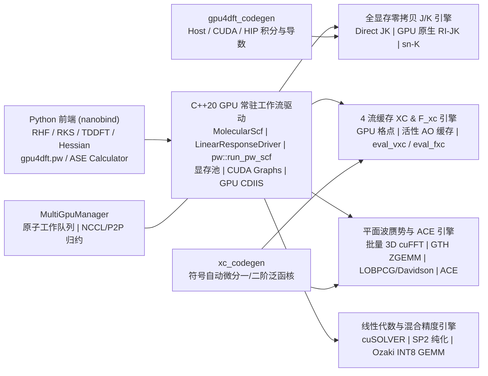

# GPU4DFT

**GPU4DFT** 是一个面向现代异构加速器（NVIDIA Ampere / Hopper / Blackwell 与 AMD Instinct MI300 系列）从零构建的 **GPU 原生第一性原理量子化学与凝聚态密度泛函理论（DFT）计算框架**，在同一 C++20/CUDA 代码库内统一涵盖**分子高斯原子轨道（GTO）自洽场、解析梯度、线性响应激发态（CIS / TDA / TDDFT / RI-TDDFT）、分子振动 Hessian** 以及**周期性平面波赝势与自适应压缩交换杂化泛函（Plane-Wave Kohn–Sham & Lin's ACE Hybrid DFT）**。

不同于将传统 CPU 代码局部移植到 GPU 的混合模式，GPU4DFT 采用**生成式单一算术真源（Codegen-First）**与**全显存零拷贝常驻流水线（Zero-Copy GPU-Resident Pipeline）**设计：在计算热路径中彻底消除 Python 解释器介入与主机—设备矩阵往返，并针对新一代 GPU（如 NVIDIA Blackwell）原生标量 FP64 受限而 FP32 / INT8 Tensor Core 算力充沛的硬件特征，引入**动态混合精度四元组路由**与 **Ozaki INT8 Tensor Core 无损双精度矩阵乘法仿真**，在严格保证相对 `PySCF`/`libcint` 机器级数值精度的同时充分释放张量核心算力。

- 架构与数学设计规范详见：[docs/ARCHITECTURE.md](docs/ARCHITECTURE.md)
- 精度门禁与性能基准方案详见：[docs/BENCHMARK_PLAN.md](docs/BENCHMARK_PLAN.md)
- Blackwell 实卡完整 7 大套件评测报告详见：[benchmarks/results/BENCHMARK_REPORT.md](benchmarks/results/BENCHMARK_REPORT.md)

---

## 核心特性

- **五层解耦 GPU 原生分子与周期性统一架构**：`nanobind` 零拷贝前端（PySCF 兼容 `RHF`/`RKS`、`.TDA()`/`.TDDFT()`/`.Hessian()`、`gpu4dft.pw` 平面波子模块与 ASE `Calculator`）$\to$ C++20 全显存常驻驱动（`DeviceMemoryPool` + `CudaGraphExecutor` 全步图固化 + `GpuDiis`，稳态迭代零 `cudaMalloc` 分配）$\to$ 高斯与平面波计算引擎层 $\to$ 双代码生成器与自动调优器 $\to$ 多 GPU 原子动态调度与集合通信层。
- **双代码生成器与跨厂商三后端（Host / CUDA / HIP）**：
  - `gpu4dft_codegen`：将任意角动量（$s, p, d, f, g$）单/双电子积分及导数（`deriv_order = 0, 1, 2`）生成为跨平台 `GPU4DFT_HD` 头文件，同步发射 OpenMP **Host**（`.cpp`）、NVIDIA **CUDA**（`.cu`）与 AMD ROCm **HIP**（`.hip`）驱动。
  - `xc_codegen`：零外部依赖的纯 Python 符号 AST 自动微分器，自动生成 LDA、GGA（B88、LYP、PBE）、Meta-GGA（TPSS）及杂化泛函（B3LYP、B3LYP5、PBE0）的一阶势导数与二阶绝热核导数（`eval_fxc`）。
- **全显存零拷贝 J/K 算法谱系（Direct JK / GPU 原生 RI-JK / 渐近筛选 `sn-K`）**：
  - **Direct J/K (`DirectJKEngine`)**：零主机往返 `compute_jk_device` + GPU 原生笛卡尔$\leftrightarrow$实球谐变换，低角动量采用 **McMurchie–Davidson + Hermite J-Engine**，高角动量采用 **Rys 求积 + 寄存器 2D VRR**，支持对称（SCF）与精确非对称（TDDFT/CPHF，`symmetrize_dm=false`）密度收缩；**在 Blackwell 上全部 `15/15` 组 Direct DFT 基准全面超越 `GPU4PySCF`（端到端快 `1.35x–5.43x`，SCF 循环快达 `6.22x`）**。
  - **100% GPU 原生密度拟合 RI-J / RI-K (`RIJKEngine`)**：GPU 原生二中心/三中心积分构建与三角求解（在 `(H2O)_16/def2-svp` 上预处理耗时从 `48.94s` 骤降至 **`0.632s`，提速 `77.4x`**），显存常驻三阶张量 `d_B` 零拷贝直供 `FP64` 与分块 `OzakiInt8` GEMM（端到端最高较 48 核 CPU PySCF 快 **`34.4x`**，在 `(H2O)_8/def2-tzvp` 上较 `GPU4PySCF` 快 **`1.75x` E2E / `2.64x` SCF**）。
  - **4 流超批缓存 `XcEngine` 与渐近筛选 `SemiNumericalK` (COSX)**：空间八叉树活性 AO 显存常驻缓存与 4 流并发 cuBLAS GEMM 使 XC 评估提速 **`14.7x–22x`**，同时提供机器精度二阶核收缩 `eval_fxc_device`（误差 $1.39\times 10^{-16}$）；渐近静电筛选使半数值交换 `sn-K` 提速 **`10.6x–14.2x`**。
- **GPU 线性响应激发态（CIS / TDA / TDHF / TDDFT / RI-TDDFT）、CPHF 极化率与分子振动 Hessian (`response.hpp`)**：
  - 全显存常驻块 Davidson 求解器与对称平方形式（SSF）Casida RPA 方程求解，无缝支持 Direct 与 `.density_fit()` **GPU RI-TDA / RI-TDDFT** 及 `OzakiInt8` Tensor Core GEMM，输出激发能、跃迁偶极矩与振子强度 $f_{\text{osc}}$（相对 48 核 CPU PySCF 加速 **`13.3x–32.1x`**，最高较 `GPU4PySCF` 快 **`2.77x`**）。
  - 内置耦合微扰 CPHF 静态极化率张量、分子电偶极矩以及固定格点热启动分子 Hessian 与 Eckart 平转投影简谐振动光谱分析（振动频率与 PySCF 偏差 **`< 0.002 cm⁻¹`**）。
- **周期性平面波赝势与 Lin's ACE 杂化泛函子系统 (`gpu4dft.pw`, `pw.hpp`)**：
  - 双空间平面波基组（`PwCell`, `PwBasis`，支持 $\Gamma$ 点与多 $\mathbf{k}$ 点）、Hartwigsen–Goedecker–Hutter (GTH) 可分模守恒赝势（解析 Fourier Kleinman–Bylander `ZGEMM` 投影）、Ewald 晶格能与 Gygi–Baldereschi 可积奇点修正、批量三维 `cuFFT`、块 Davidson / `LOBPCG` 本征求解器，以及 **Lin 自适应压缩交换（ACE）** 杂化泛函加速（在金刚石硅超晶胞上较 `PySCF-PBC` 快 **`162.7x–193.3x`**，较 48 核 OpenMP Host 快 **`8.78x`**，ACE 压缩减少 **`10.5x–16.6x`** Poisson FFT 并带来 **`1.41x–1.85x`** GPU 净加速）。
- **Blackwell Tensor Core 精度引擎与无对角化纯化**：
  - **Ozaki INT8 无损 GEMM (`GemmMode::OzakiInt8`)**：8 切片 7-bit 有符号分解在 INT8 Tensor Core 上精确重构 FP64 矩阵乘法，在 RTX PRO 6000 Blackwell 上达 **9.73–9.79 TFLOPS（相对原生 `cublasDgemm` 加速 6.31x–6.40x，相对误差 $\le 2.14 \times 10^{-15}$）**。
  - **双轨求解与 CUDA Graphs**：支持 `cuSOLVER` 分治对角化（`solve_fock_diag`）与零特征分解 **Niklasson SP2 二阶迹重置纯化（`solve_fock_sp2`）**，均由 `CudaGraphExecutor` 固化重放。

---

## 总体架构与仓库目录结构



```text
GPU4DFT/
├── CMakeLists.txt                 # CMake >= 3.24 构建系统（链接 cudart / cublas / cusolver / cufft）
├── pyproject.toml                 # scikit-build-core + nanobind Python 包配置
├── docs/
│   ├── ARCHITECTURE.md            # 高斯五层架构、响应理论、平面波 ACE 子系统与 C++20 接口规范
│   └── BENCHMARK_PLAN.md          # <= 1e-10 精度验收准则与性能基准评测协议
├── benchmarks/
│   ├── run_benchmarks.py          # 7 大套件自动化对标评测 (GEMM / ERI / Ablation / SCF / Grad / TDDFT / PW-DFT)
│   └── results/                   # NVIDIA Blackwell 实卡完整评测 JSON 与汇总报告 (BENCHMARK_REPORT.md)
├── codegen/
│   ├── gpu4dft_codegen/           # 单/双电子积分及导数代码生成器（Host / CUDA / HIP + autotune.py）
│   └── xc_codegen/                # 零外部依赖符号自动微分 XC 泛函生成器（LDA/GGA/MGGA/Hybrids 一二阶导数）
├── include/gpu4dft/               # C++20 公共头文件
│   ├── config.hpp, types.hpp      # GPU4DFT_HD 跨平台宏、Backend(Host/Cuda/Hip)、Precision(FP64/FP32/Mixed)
│   ├── basis.hpp, harmonics.hpp   # 收缩高斯基组径向归一化与 PySCF 兼容实固体球谐序
│   ├── boys.hpp, rys.hpp          # 零相消 Kummer Boys 向量 F_m(T) 与 Rys 正交求积根/权重
│   ├── shell_pair_view.hpp, shell_pairs.hpp # 壳对 SoA 视图与 Schwarz 上界降序重排
│   ├── one_electron.hpp, eri.hpp  # 单电子积分 (S, T, V_nuc)、电偶极矩积分、四阶张量与 1e 核梯度
│   ├── jk_engine.hpp, snk.hpp     # 零拷贝 DirectJKEngine、GPU 原生 RIJKEngine、渐近筛选 SemiNumericalK
│   ├── xc.hpp                     # MolecularGrid (M4+Lebedev+SSF)、4 流 AO 缓存 XcEngine (V_xc & F_xc)
│   ├── device_pool.hpp, diis.hpp  # 流有序显存池 DeviceMemoryPool、CudaGraphExecutor 与 GPU 常驻 CDIIS
│   ├── linalg.hpp, multigpu.hpp   # FP64/FP32/OzakiInt8 GEMM、cuSOLVER、SP2 纯化与多卡动态调度
│   ├── scf.hpp, workflow.hpp      # 全显存常驻 ScfDriver 与端到端 MolecularScf (SCF / Grad / TDDFT / Hessian)
│   ├── response.hpp               # CIS / TDA / TDHF / TDDFT 线性响应激发态、CPHF 极化率与分子振动 Hessian
│   └── pw.hpp                     # 周期性平面波赝势 Kohn-Sham、GTH 赝势、cuFFT、LOBPCG/Davidson 与 ACE 杂化引擎
├── src/                           # C++20 实现与 src/cuda/ CUDA 内核 (jk, xc, snk, linalg, response, pw 等)
├── python/                        # nanobind 扩展 (_core, _core.pw) 与高层 API (RHF, RKS, pw, GPU4DFTCalculator)
└── tests/                         # C++ 单元测试 (cpp.boys, cpp.rys) 与 338 项 PySCF 对照回归测试 (共 340 项全绿)
```

---

## 构建与测试

### 依赖环境
- **编译工具链**：CMake $\ge 3.24$、支持 C++20 的编译器（GCC $\ge 11$ / Clang $\ge 14$）、Ninja（推荐）、OpenMP（可选，加速 Host 后端）。
- **GPU 工具链（可选）**：NVIDIA CUDA Toolkit $\ge 12.0$（含 `cudart`, `cublas`, `cusolver`, `cufft`；Blackwell 推荐 CUDA 12.8 / 13.0）或 AMD ROCm HIP 工具链。无 GPU 时自动退回纯 CPU OpenMP 参考后端（含内置 Stockham / Bluestein 三维 FFT）。
- **Python 环境**：Python $\ge 3.10$、`nanobind >= 2.0`、`numpy`；运行验证测试需安装 `pytest` 与 `pyscf`。

### 标准 CMake 构建与测试

```bash
# 1. 安装 Python 构建与测试依赖
pip install "nanobind>=2.0" numpy pytest pyscf

# 2. 配置构建（在配备 GPU 的机器上建议指定 native 架构，如 Blackwell sm_120）
cmake -S . -B build -G Ninja -DCMAKE_BUILD_TYPE=Release -DCMAKE_CUDA_ARCHITECTURES=native

# 3. 并行编译（自动触发构建期积分与符号 XC 内核生成，93 个编译目标零警告通过 -Werror）
cmake --build build -j

# 4. 运行全部 340 项 C++ 与 Python 对照测试（cpp.boys + cpp.rys + 9 大套件 338 项 pytest，0 跳过）
ctest --test-dir build --output-on-failure

# 或通过 scikit-build-core 直接安装为标准 Python 包
pip install .
```

### CMake 构建选项

| CMake 选项 | 默认值 | 说明 |
| :--- | :--- | :--- |
| `GPU4DFT_ENABLE_CUDA` | `ON` | 检测到 `nvcc` 编译器时自动启用 CUDA 后端（链接 `cudart`/`cublas`/`cusolver`/`cufft`） |
| `GPU4DFT_REQUIRE_CUDA` | `OFF` | 设为 `ON` 时若未找到 CUDA 工具链则配置报错终止 |
| `GPU4DFT_ENABLE_HIP` | `OFF` | 检测到 `hipcc` 时启用 AMD ROCm HIP 后端 |
| `GPU4DFT_BUILD_PYTHON` | `ON` | 构建 `nanobind` Python 扩展模块 `gpu4dft._core`（含 `_core.pw` 子模块） |
| `GPU4DFT_BUILD_TESTS` | `ON` | 构建 C++ 测试可执行文件并注册全套 `CTest` 测试集 |
| `CMAKE_CUDA_ARCHITECTURES` | `80;90` | 目标 NVIDIA SM 架构（如 A100=`80`、H100=`90`、Blackwell 建议设 `native` 或 `120`） |

---

## 快速上手与模块使用示例

### 1. 分子自洽场（Direct / RI-JK / `sn-K`）、解析梯度、TDDFT 激发态与振动 Hessian (`Python`)

`gpu4dft.RHF` 与 `gpu4dft.RKS` 在底层直接调用全显存常驻的 C++20/CUDA `MolecularScf` 与 `LinearResponseDriver`，一行代码即可无缝运行基态 SCF、解析核梯度、Direct / RI-TDDFT 激发态光谱及简谐振动频率：

```python
from pyscf import gto
import gpu4dft

mol = gto.M(
    atom="O 0.0 0.0 0.1173; H 0.0 0.7572 -0.4692; H 0.0 -0.7572 -0.4692",
    basis="def2-svp",
    unit="Angstrom",
    verbose=0,
)

# 1) Direct Hybrid DFT (B3LYP) + Ozaki INT8 Tensor Core GEMM + 电偶极矩
mf = gpu4dft.RKS(mol, xc="b3lyp", gemm_mode="ozaki_int8", conv_tol=1e-9).run()
dip_debye = mf.dipole_moment(unit="Debye")

# 2) GPU 原生密度拟合 RI-JK + 解析核梯度 + GPU RI-TDDFT / RI-TDA 激发态
mf_ri = gpu4dft.RKS(mol, xc="b3lyp", gemm_mode="ozaki_int8").density_fit("def2-universal-jkfit").run()
grad = mf_ri.nuc_grad_method().kernel()          # 解析核梯度 shape: (natom, 3) [Eh/Bohr]

td = mf_ri.TDDFT(nstates=5).run()                # 亦支持 mf.TDA(), mf.CIS(), mf.TDHF()
print("Excitation energies (eV):", td.e_ev)
print("Oscillator strengths f_osc:", td.f_osc)

# 3) 分子核 Hessian 与简谐振动频率分析 (cm^-1, 自动剔除平动/转动零模)
hess_obj = mf_ri.Hessian(step_bohr=1e-3).run()
print("Hessian shape:", hess_obj.de.shape)       # shape: (natom, natom, 3, 3) [Eh/Bohr^2]
print("Harmonic frequencies (cm^-1):", hess_obj.frequencies_cm1)
```

### 2. 周期性晶体平面波赝势 Kohn–Sham 与 Lin's ACE 杂化泛函 (`gpu4dft.pw`)

`gpu4dft.pw` 提供原生的周期性边界条件（PBC）平面波赝势计算，支持从晶格矩阵或 `pyscf.pbc.gto.Cell` 直接建模，并通过自适应压缩交换算符（ACE）加速 `PBE0` / `B3LYP` / `HF` 杂化泛函：

```python
import numpy as np
import gpu4dft.pw as pw

# 构造金刚石硅原胞 (Bohr 晶格基矢, GTH-PBE 模守恒赝势)
a_bohr = 5.43 * 1.8897259886
lattice = np.array([[0.0, 0.5, 0.5], [0.5, 0.0, 0.5], [0.5, 0.5, 0.0]]) * a_bohr
coords = np.array([[0.0, 0.0, 0.0], [0.25, 0.25, 0.25]]) * a_bohr
cell = pw.PwCell(lattice, [14, 14], coords, pseudo_family="gth-pbe")

# GPU 批量 3D cuFFT + Kleinman-Bylander ZGEMM + Lin's ACE 压缩精确交换 PBE0
mf_pw = pw.RKS(cell, xc="pbe0", ecut_wfc=18.0, backend="cuda", use_ace=True, solver="davidson")
e_tot = mf_pw.kernel()
print(f"Diamond Si2 PBE0 Energy = {e_tot:.10f} Eh | Poisson FFTs = {mf_pw.scf_result.total_poisson_ffts}")
```

### 3. 底层积分、零拷贝设备引擎与代码生成器 CLI (`Python` & `C++20`)

```python
import gpu4dft

# Blackwell Ozaki INT8 Tensor Core vs 原生 cublasDgemm FP64 吞吐与误差实测
res = gpu4dft.benchmark_gemm(4096, backend="cuda", ozaki_slices=8)
print(f"FP64: {res.fp64_tflops:.2f} TFLOPS | Ozaki INT8: {res.ozaki_tflops:.2f} TFLOPS "
      f"| rel_err={res.ozaki_rel_error:.2e}")
```

```bash
# 独立生成 Host (.cpp)、NVIDIA CUDA (.cu) 与 AMD ROCm HIP (.hip) 积分及符号自动微分 XC 内核
PYTHONPATH=codegen python -m gpu4dft_codegen --backends host,cuda,hip --out-dir build/generated_hip
PYTHONPATH=codegen python -m xc_codegen --backends host,cuda,hip --out-dir build/generated_hip
```

---

## NVIDIA Blackwell (`sm_120`) 实卡验证与 7 大套件对标摘要

全套测试与 7 大性能基准已在 **NVIDIA RTX PRO 6000 Blackwell Server Edition**（`sm_120`，188 SMs，98 GB GDDR7，CUDA 13.0 `nvcc` 13.0.88，宿主机 48 核 AMD EPYC，对比软件栈 `PySCF 2.15.1` 与 `GPU4PySCF 1.9.2`）上完成实测验证：

- **全量回归测试 100% 零跳过通过（`340/340`）**：`cpp.boys`、`cpp.rys` 及 9 大 Python 测试模块共 **`338/338` 项 `pytest` 用例**（`test_end_to_end_dft` `76/76`、`test_xc_and_snk` `69/69`、`test_linalg_scf` `61/61`、`test_tddft_response` `56/56`、`test_integrals_jk` `31/31`、`test_pw_dft` `23/23` 等，`0` 失败、`0` 跳过）。所有 GPU SCF 稳态迭代显存分配次数严格为 `steady_state_allocations == 0`。

### 1. Ozaki INT8 Tensor Core 无损仿真与求解器/CUDA Graphs 消融

在原生标量 FP64 受限（~1.54 TFLOPS）的 Blackwell 架构上，8 切片 `OzakiInt8` 借助 INT8 Tensor Core 达 **9.73 TFLOPS（相对原生 `cublasDgemm` 加速 `6.31x`，相对误差 `2.14e-15`）**；在 `C12H26/def2-svp`（$N_{\text{AO}}=298$，RI-RHF）上，`Diag (OzakiInt8 + Graph)`（**1259.5 ms**）与无对角化 `SP2 (OzakiInt8 + Graph)`（**1277.5 ms**，59 次图重放）均显著超越原生 `Diag (FP64)`（**1687.3 ms**），能量差 $|\Delta E| \le 9.09 \times 10^{-13}\ E_\text{h}$：

| 矩阵维度 $N$ | 原生 `FP64` (TFLOPS) | **`OzakiInt8` (TFLOPS)** | 相对 `FP64` 加速比 | `FP32` TC (TFLOPS) | Ozaki 相对 Frobenius 误差 |
| ---: | ---: | ---: | ---: | ---: | :--- |
| `1003` *(非对齐)* | 1.32 | **2.41** | **1.82x** | 42.44 | `7.54e-16` |
| `1024` | 1.41 | **2.81** | **1.99x** | 53.25 | `7.61e-16` |
| `2048` | 1.54 | **5.82** | **3.78x** | 80.11 | `1.07e-15` |
| `4096` | 1.54 | **9.73** | **6.31x** | 120.42 | `2.14e-15` |

### 2. 端到端分子 SCF 与解析核梯度对标（15/15 组 Direct SCF 全面超越 GPU4PySCF！）

在全部 15 组基准分子/基组（$N_{\text{AO}} = 36 \dots 384$，`conv_tol = 1e-9`）上，GPU4DFT 收敛能量与 `PySCF` 偏差严格落在 **$3.98\times 10^{-13} \sim 2.08\times 10^{-10}\ E_\text{h}$**，其中 **`Direct_FP64` 在全部 `15/15` 组算例上端到端全面超越 `GPU4PySCF`（快 `1.35x–5.43x`）**，100% GPU 原生 `RI-JK` 预处理最高提速 **`77.4x`**：

| 评测项目与代表体系 | 基组 / 方法 ($N_{\text{AO}}$) | GPU4DFT $T_{\text{E2E}}$ (s) | 48 核 PySCF (s) | GPU4PySCF (s) | 精度 ($|\Delta E|$ 或 $\max|\Delta\mathbf{g}|$) | 加速亮点 |
| :--- | :--- | ---: | ---: | ---: | :--- | :--- |
| **`(H2O)_2` Direct SCF** | `6-31g*` / B3LYP (36) | **0.495** | 2.455 | 2.686 | `2.96e-12` $E_\text{h}$ | **5.43x E2E (6.22x SCF) vs GPU4PySCF** / 5.0x vs CPU |
| **`C6H6` Direct SCF** | `def2-svp` / B3LYP (114) | **1.223** | 6.797 | 4.195 | `1.71e-12` $E_\text{h}$ | **3.43x E2E (3.49x SCF) vs GPU4PySCF** / 5.6x vs CPU |
| **`(H2O)_8` Direct SCF** | `def2-svp` / B3LYP (192) | **1.795** | 13.055 | 5.139 | `2.08e-10` $E_\text{h}$ | **2.86x E2E (3.00x SCF) vs GPU4PySCF** / **7.3x vs CPU** |
| **`(H2O)_16` Direct SCF** | `def2-svp` / B3LYP (384) | **7.583** | — | 10.264 | `1.67e-10` $E_\text{h}$ | **1.35x E2E vs GPU4PySCF**（全 15 组 Direct 大满贯胜出） |
| **`C6H6` RI-JK SCF** | `def2-svp` / B3LYP (114) | **0.265** | 9.115 | 0.332 | `1.65e-12` $E_\text{h}$ | **34.4x vs CPU** / **1.25x E2E (2.04x SCF) vs GPU4PySCF** |
| **`(H2O)_8` RI-JK SCF** | `6-31g*` / B3LYP (144) | **0.438** | 13.622 | 0.586 | `1.12e-10` $E_\text{h}$ | **31.1x vs CPU** / **1.34x E2E (1.94x SCF) vs GPU4PySCF** |
| **`(H2O)_8` RI-JK (`OzakiInt8`)** | `def2-tzvp` / PBE (344) | **0.916** | 21.562 | 1.598 | `4.32e-12` $E_\text{h}$ | **23.6x vs CPU** / **1.75x E2E (2.64x SCF) vs GPU4PySCF** |
| **`(H2O)_16` RI-JK (`OzakiInt8`)** | `def2-svp` / B3LYP (384) | **4.254** *($T_{\text{setup}}=0.634\text{s}$)* | 37.624 | 3.034 | `5.30e-11` $E_\text{h}$ | **8.8x vs CPU**（GPU 原生 2c/3c 预处理提速 **77.4x**） |
| **`C6H6` 解析核梯度** | `def2-svp` / RHF (114) | **0.182** | 1.860 | 0.425 | `3.48e-07` $E_\text{h}/a_0$ | **10.2x vs CPU** / **2.34x vs GPU4PySCF** |
| **`C6H6` 解析核梯度** | `def2-svp` / B3LYP (114) | **0.209** | 2.046 | 0.478 | `8.94e-08` $E_\text{h}/a_0$ | **9.8x vs CPU** / **2.29x vs GPU4PySCF** |
| **`(H2O)_8` 解析核梯度** | `6-31g*` / B3LYP (144) | **0.370** | 2.994 | 0.668 | `2.32e-07` $E_\text{h}/a_0$ | **8.1x vs CPU** / **1.80x vs GPU4PySCF** |

### 3. GPU 线性响应激发态（TDDFT / RI-TDDFT / TDA）对标

求解最低 5 个单重激发态及振子强度 $f_{\text{osc}}$，激发能与 `PySCF` 最大偏差 $2.15\times 10^{-10} \sim 5.97\times 10^{-7}\ E_\text{h}$，相对 48 核 CPU PySCF 加速 **`13.3x–32.1x`**，并在纯泛函及 TDA 场景超越 `GPU4PySCF` 最高达 **`2.77x`**：

| 体系 (`def2-svp`) | $N_{\text{AO}}$ | 泛函 / 响应模式 | $E_1$ (eV) | $\max|\Delta\omega|$ ($E_\text{h}$) | GPU4DFT $T_{\text{TD}}$ (s) | 48 核 PySCF (s) | GPU4PySCF (s) | 加速亮点 |
| :--- | ---: | :--- | ---: | :--- | ---: | ---: | ---: | :--- |
| **`C6H6`** | 114 | `B3LYP` / `RI_TDDFT_fp64` | 5.479 | `2.15e-10` | **1.980** | 63.520 | 1.449 | **32.1x TD / 32.4x E2E vs CPU** |
| **`C6H6`** | 114 | `B3LYP` / `RI_TDA_ozaki_int8` | 5.504 | `2.82e-08` | **1.066** | 26.228 | 1.571 | **24.6x vs CPU** / **1.47x vs GPU4PySCF** |
| **`(H2O)_8`** | 192 | `PBE` / `RI_TDDFT_fp64` | 4.208 | `5.89e-07` | **1.611** | 39.916 | 4.465 | **24.8x TD / 28.2x E2E vs CPU** / **2.77x vs GPU4PySCF** |
| **`(H2O)_8`** | 192 | `PBE` / `RI_TDDFT_ozaki_int8` | 4.208 | `5.87e-07` | **1.680** | 39.916 | 4.465 | **23.8x vs CPU** / **2.66x vs GPU4PySCF** |
| **`(H2O)_8`** | 192 | `B3LYP` / `RI_TDDFT_fp64` | 5.623 | `5.92e-07` | **6.603** | 155.233 | 4.400 | **23.5x vs 48 核 CPU PySCF** |
| **`aspirin`** | 222 | `B3LYP` / `RI_TDDFT_fp64` | 4.315 | `1.70e-07` | **11.437** | 217.026 | 6.078 | **19.0x vs 48 核 CPU PySCF** |

### 4. 周期性平面波赝势 Kohn–Sham 与 Lin's ACE 杂化泛函对标 (`gpu4dft.pw`)

| 晶体超晶胞 | 泛函 | $E_{\text{cut}}$ (Ha) | FFT 网格 ($N_{\text{PW}}$) | $|\Delta E|$ ($E_\text{h}$) | **GPU CUDA (ms)** | 48 核 Host (ms) | 未压缩 GPU (ms) | PySCF-PBC (ms) | 加速亮点 |
| :--- | :--- | ---: | :--- | :--- | ---: | ---: | ---: | ---: | :--- |
| **`Diamond Si2`** | `PBE` | 10.0 | `24x24x24` (411) | `3.82e-14` | **30.99** | 91.4 | — | 5990.7 | **193.3x vs PySCF-PBC** / 2.95x vs Host |
| **`Diamond Si2`** | `PBE0` | 10.0 | `24x24x24` (411) | `1.08e-08` | **58.20** | 184.7 | 50.62 | 9472.1 | **162.7x vs PySCF-PBC** / 3.17x vs Host |
| **`Diamond Si2`** | `PBE0` | 15.0 | `27x27x27` (749) | `1.20e-10` | **79.76** | 233.1 | 112.21 | — | **1.41x ACE 提速**（少 **16.6x** Poisson FFT） |
| **`Diamond Si4 (2x1x1)`** | `PBE0` | 18.0 | `60x30x30` (1943) | `1.15e-09` | **160.79** | 1071.7 | 245.77 | — | **6.67x vs Host** / **1.53x ACE 提速**（少 **13.5x** FFT） |
| **`Diamond Si8 (2x2x1)`** | `PBE` | 20.0 | `64x64x32` (4617) | `4.97e-14` | **398.16** | 3496.3 | — | — | **8.78x vs 48 核 OpenMP Host** |
| **`Diamond Si8 (2x2x1)`** | `PBE0` | 16.0 | `60x60x30` (3339) | `1.19e-10` | **521.85** | 4584.3 | 964.98 | — | **8.78x vs Host** / **1.85x ACE 提速**（少 **10.5x** FFT） |

完整的 7 大套件全部算例耗时明细与原始 JSON 记录请参阅 [benchmarks/results/BENCHMARK_REPORT.md](benchmarks/results/BENCHMARK_REPORT.md) 与 [docs/BENCHMARK_PLAN.md](docs/BENCHMARK_PLAN.md)。
