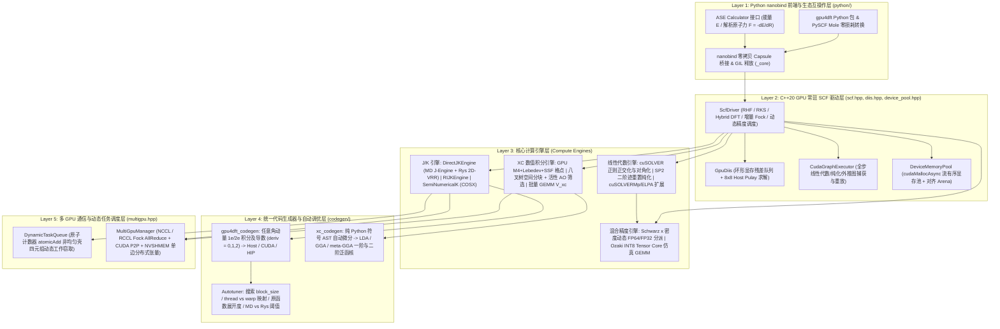
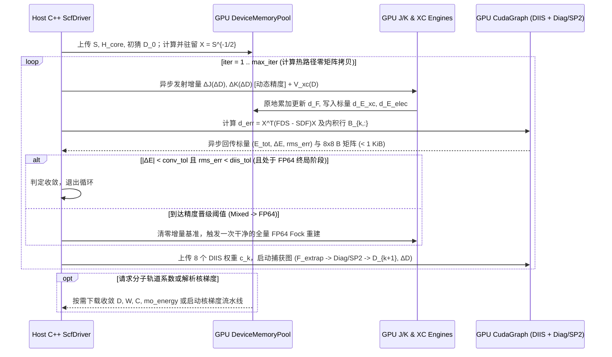
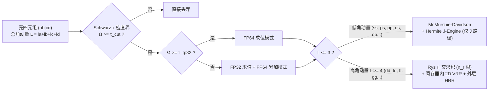
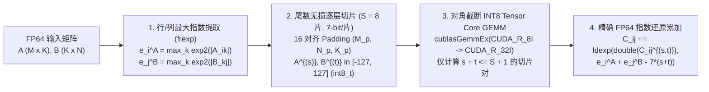
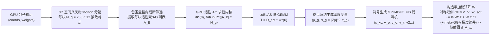
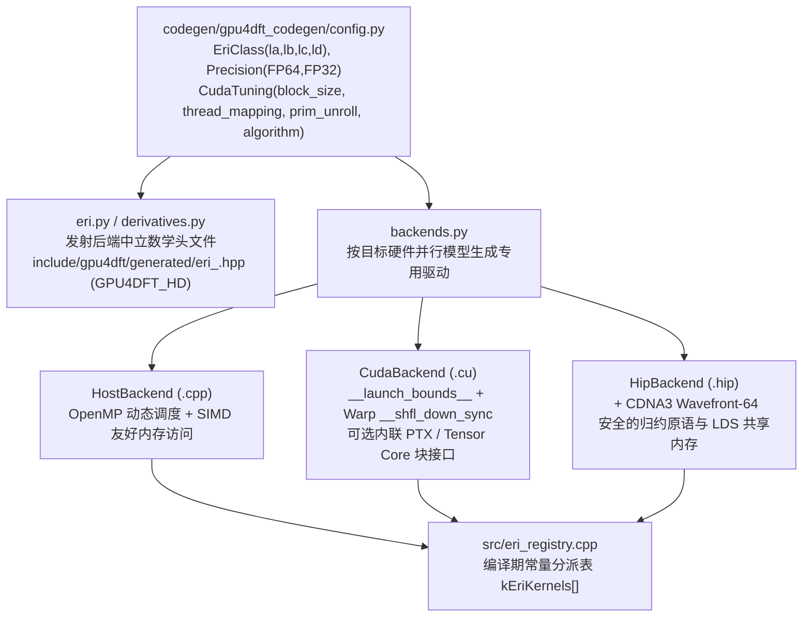
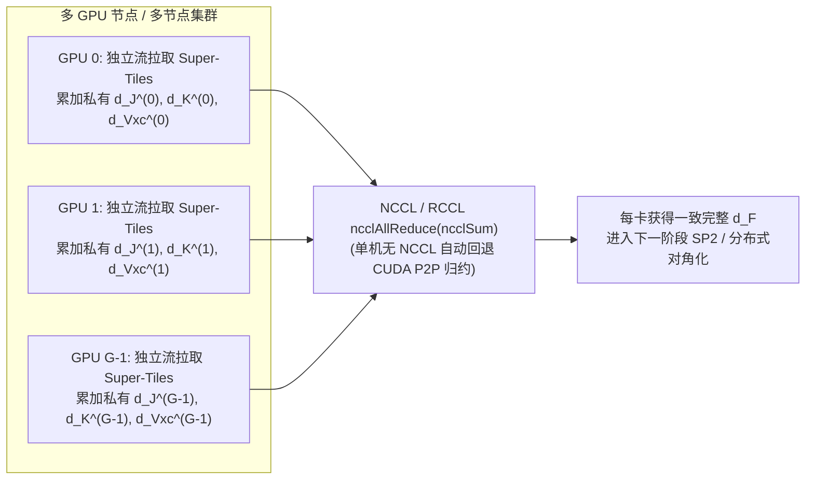
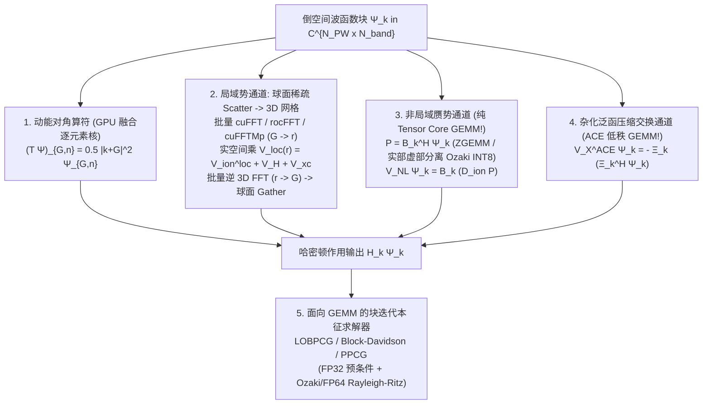

# GPU4DFT 软件架构与数学设计规范

> **版本**：0.2.0-arch  
> **定位**：面向新一代异构加速器（NVIDIA Ampere / Hopper / Blackwell 与 AMD CDNA3 MI300）的 GPU 原生第一性原理量子化学与密度泛函理论（DFT）计算框架。

---

## 目录

1. [设计哲学与全局数学约定](#1-设计哲学与全局数学约定)
2. [五层高斯体系总体架构](#2-五层高斯体系总体架构)
3. [第一层：Python `nanobind` 前端与生态互操作层](#3-第一层python-nanobind-前端与生态互操作层)
4. [第二层：C++20 GPU 常驻自洽场（SCF）驱动层](#4-第二层c20-gpu-常驻自洽场scf驱动层)
5. [第三层：核心计算引擎层](#5-第三层核心计算引擎层)
   - [5.1 单/双电子积分与多算法 J/K 引擎（Direct JK / RI-JK / sn-K）](#51-单双电子积分与多算法-jk-引擎direct-jk--ri-jk--sn-k)
   - [5.2 混合精度与 Tensor Core 算术引擎（动态四元组路由与 Ozaki INT8 方案）](#52-混合精度与-tensor-core-算术引擎动态四元组路由与-ozaki-int8-方案)
   - [5.3 交换关联（XC）数值积分与符号自动微分泛函引擎](#53-交换关联xc数值积分与符号自动微分泛函引擎)
   - [5.4 线性代数与无对角化密度矩阵纯化引擎（cuSOLVER / SP2 / 分布式特征求解）](#54-线性代数与无对角化密度矩阵纯化引擎cusolver--sp2--分布式特征求解)
6. [第四层：统一代码生成器与自动调优层](#6-第四层统一代码生成器与自动调优层)
7. [第五层：多 GPU 通信与动态负载均衡调度层](#7-第五层多-gpu-通信与动态负载均衡调度层)
8. [平面波赝势 DFT（Plane-Wave DFT）扩展蓝图](#8-平面波赝势-dftplane-wave-dft扩展蓝图)
9. [分阶段数值验证与性能回归路线图](#9-分阶段数值验证与性能回归路线图)

---

## 1. 设计哲学与全局数学约定

### 1.1 四大核心工程准则

传统量子化学程序（如早期移植版 CPU 代码）在 GPU 上往往面临三大系统性瓶颈：**频繁的 Host–Device PCIe 矩阵往返**、**高角动量双电子积分（ERI）导致的寄存器溢出与 Warp 分支发散**，以及**在现代 AI 导向 GPU（如 NVIDIA Blackwell）上过度依赖受限的原生标量 FP64 单元而闲置海量 Tensor Core 算力**。GPU4DFT 从零构建，确立四大核心设计准则：

1. **计算热路径零 Python 介入与全显存常驻（GPU-Resident Hot Path）**：Python 仅承担分子建模、基组解析与工作流编排；一旦进入 C++20 `ScfDriver`，重叠矩阵 $\mathbf{S}$、正交化矩阵 $\mathbf{X}$、核心哈密顿量 $\mathbf{H}_{\text{core}}$、密度矩阵 $\mathbf{D}$、Fock 矩阵 $\mathbf{F}$ 及 CDIIS 历史残差队列全部常驻 GPU 显存。每步 SCF 迭代仅通过异步流回传标量能量与残差（$< 1\text{ KiB}$）。
2. **代码生成器驱动的单一算术真源（Generator-Centric Single Source of Truth）**：积分递推数学与交换关联（XC）泛函导数均由零外部运行时依赖的 Python 代码生成器产出为跨平台 `GPU4DFT_HD`（`__host__ __device__`）内联模板头文件。CPU OpenMP 参考后端与 NVIDIA CUDA / AMD HIP 后端执行**完全相同的代数指令树**，使 Host 单元测试直接验证 GPU 内核的算术正确性。
3. **面向 Tensor Core 的精度解耦与无损仿真（Precision Decoupling & Ozaki Emulation）**：
   - 在积分端：利用壳对 Schwarz 上界与密度矩阵块范数构造严格先验误差界，动态将海量弱耦合壳四元组路由至 `FP32` 原函数求值 + `FP64` 寄存器累加路径。
   - 在矩阵乘法端：针对 NVIDIA Blackwell 等架构 INT8 Tensor Core 吞吐远超原生 FP64 数十倍的硬件特性，内置 **Ozaki 无误差尾数切片方案**，通过 `cublasGemmEx`（`CUDA_R_8I` $\to$ `CUDA_R_32I`）在 INT8 Tensor Core 上精确重构 `FP64` 级矩阵乘法（相对误差 $< 10^{-13}$）。
4. **流有序内存管理与计算图固化（Stream-Ordered Pool & CUDA Graphs）**：通过 `cudaMallocAsync` 显存池消除运行期隐式全局同步，并利用 `CudaGraphExecutor` 将固定拓扑的 CDIIS 外推、正交变换与 SP2 密度矩阵纯化多项式迭代捕获为单图，实现微秒级零主机开销重放。

### 1.2 全局单位、基函数归一化与实球谐排序约定

为确保与 `PySCF` / `libcint` / `Libxc` 达到 $\le 10^{-12}$ 的逐元素一致性，全库严格遵循以下数学约定：

- **原子单位制（Atomic Units）**：所有空间坐标 $\mathbf{R}_A, \mathbf{r}$ 均以 **Bohr ($a_0$)** 为单位，能量以 **Hartree ($E_\text{h}$)** 为单位，核梯度以 **$E_\text{h}/a_0$** 为单位。
- **高斯基函数径向归一化约定**（见 `include/gpu4dft/basis.hpp` 与 `src/basis.cpp`）：  
  外部输入的收缩系数 $c_{k}^{\text{in}}$ 遵循标准基组文件与 `PySCF` `mol.bas_ctr_coeff` 约定（即乘在自身已归一化的原始高斯函数上）。`gpu4dft::Basis` 构造函数内部利用径向矩公式
  $$M(l, \alpha) = \int_0^\infty r^{2l+2} e^{-\alpha r^2}\,\mathrm{d}r = \frac{\Gamma\left(l + \frac{3}{2}\right)}{2\alpha^{l + 3/2}}$$
  将其转换为乘在**未归一化原始径向函数** $r^l e^{-\alpha_k r^2}$ 上的收缩系数 $c_k$，并对整个收缩壳施加单位径向范数归一化 $\int_0^\infty R_a(r)^2 r^2\,\mathrm{d}r = 1$：
  $$c_k^{(0)} = \frac{c_k^{\text{in}}}{\sqrt{M(l, 2\alpha_k)}}, \qquad c_k = \frac{c_k^{(0)}}{\sqrt{\sum_{p,q} c_p^{(0)} c_q^{(0)} M(l, \alpha_p + \alpha_q)}}$$
  完整的收缩实球谐原子轨道（AO）定义为 $\phi_{a,m}(\mathbf{r}) = R_a(|\mathbf{r}-\mathbf{A}|)\, S_{lm}(\mathbf{r}-\mathbf{A})$，其中 $S_{lm}$ 为实固体球谐函数（Real Solid Harmonics, $|\mathbf{r}|^l Y_{lm}^{\text{real}}(\theta,\varphi)$）。
- **PySCF 兼容实球谐 AO 排序约定**（`mol.cart = False`，见 `include/gpu4dft/harmonics.hpp`）：
  - **$l = 0$（$s$ 壳，1 个 AO）**：$Y_{00} = \frac{1}{\sqrt{4\pi}}$。
  - **$l = 1$（$p$ 壳，3 个 AO）**：严格遵循 `PySCF`/`libcint` 特殊约定，采用笛卡尔 **`px, py, pz` 顺序**，即 $\sqrt{\frac{3}{4\pi}}\{x, y, z\}$（对应磁量子数 $m = +1, -1, 0$，**而非** $m = -1, 0, +1$）。
  - **$l \ge 2$（$d, f, g$ 壳，$2l+1$ 个 AO）**：遵循 Schlegel & Frisch (1995) 标准实固体球谐定义，按 $m = -l, -l+1, \dots, +l$ 升序排列。例如 $l=2$（$d$ 壳）顺序为 $(d_{xy}, d_{yz}, d_{z^2}, d_{xz}, d_{x^2-y^2})$。
- **闭壳层矩阵、密度与能量约定**：  
  所有维度为 $N_{\text{AO}} \times N_{\text{AO}}$ 的矩阵在 Host 与 Device 上均以**行优先（Row-Major）连续 `double` 数组**存储。对于含 $N_{\text{elec}}$ 个电子的闭壳层体系（占据轨道数 $N_{\text{occ}} = N_{\text{elec}}/2$）：
  $$\mathbf{D} = 2\mathbf{C}_{\text{occ}}\mathbf{C}_{\text{occ}}^\top, \qquad \mathrm{Tr}(\mathbf{D}\mathbf{S}) = N_{\text{elec}}, \qquad \mathbf{W} = 2\mathbf{C}_{\text{occ}}\operatorname{diag}(\boldsymbol{\varepsilon}_{\text{occ}})\mathbf{C}_{\text{occ}}^\top$$
  库仑矩阵 $\mathbf{J}$、交换矩阵 $\mathbf{K}$、Kohn–Sham / Hartree–Fock 矩阵 $\mathbf{F}$ 及总能量 $E_{\text{tot}}$ 定义为（化学家记号 $(\mu\nu|\lambda\sigma) = \iint \phi_\mu(\mathbf{r}_1)\phi_\nu(\mathbf{r}_1) r_{12}^{-1} \phi_\lambda(\mathbf{r}_2)\phi_\sigma(\mathbf{r}_2)\,\mathrm{d}\mathbf{r}_1\mathrm{d}\mathbf{r}_2$）：
  $$J_{\mu\nu}(\mathbf{D}) = \sum_{\lambda\sigma} (\mu\nu|\lambda\sigma) D_{\lambda\sigma}, \qquad K_{\mu\nu}(\mathbf{D}) = \sum_{\lambda\sigma} (\mu\lambda|\nu\sigma) D_{\lambda\sigma}$$
  $$\mathbf{F}(\mathbf{D}) = \mathbf{H}_{\text{core}} + \mathbf{J}(\mathbf{D}) - \frac{1}{2}\alpha_x \mathbf{K}(\mathbf{D}) + \mathbf{V}_{\text{xc}}(\mathbf{D})$$
  $$E_{\text{tot}} = E_{\text{nuc}} + \mathrm{Tr}(\mathbf{D}\mathbf{H}_{\text{core}}) + \frac{1}{2}\mathrm{Tr}\big(\mathbf{D}\mathbf{J}(\mathbf{D})\big) - \frac{1}{4}\alpha_x \mathrm{Tr}\big(\mathbf{D}\mathbf{K}(\mathbf{D})\big) + E_{\text{xc}}[\rho, \sigma, \tau]$$
  其中纯 RHF 取 $\alpha_x = 1, E_{\text{xc}} = 0$；纯泛函（LDA/GGA/meta-GGA）取 $\alpha_x = 0$；杂化泛函（如 B3LYP $\alpha_x = 0.20$，PBE0 $\alpha_x = 0.25$）由泛函定义决定精确交换比例。

---

## 2. 五层高斯体系总体架构

GPU4DFT 高斯原子轨道（GTO）子系统自顶向下划分为职责正交的五个层次：



### 仓库模块与源码映射表

| 架构层级 | 公共头文件 (`include/gpu4dft/`) | 实现与构建期代码生成 (`src/`, `codegen/`) | 核心职责 |
| :--- | :--- | :--- | :--- |
| **Layer 1: 前端层** | — | `python/bindings.cpp`, `python/gpu4dft/__init__.py`, `python/gpu4dft/pyscf_interface.py` | `nanobind` C++20 绑定、零拷贝 `ndarray` 胶囊封装、PySCF/ASE 互操作 |
| **Layer 2: SCF 驱动层** | `device_pool.hpp`, `diis.hpp`, `scf.hpp` | `src/cuda/device_pool.cu`, `src/diis.cpp`, `src/cuda/diis_cuda.cu`, `src/scf.cpp` | 流有序显存池、CUDA Graphs 捕获、GPU CDIIS、无主机干预 SCF 闭环与核梯度组装 |
| **Layer 3a: 积分与 J/K** | `basis.hpp`, `boys.hpp`, `rys.hpp`, `harmonics.hpp`, `shell_pair_view.hpp`, `shell_pairs.hpp`, `eri.hpp`, `one_electron.hpp`, `jk_engine.hpp`, `snk.hpp` | `src/basis.cpp`, `src/shell_pairs.cpp`, `src/eri.cpp`, `src/cuda/eri_cuda.cu`, `src/one_electron.cpp`, `src/cuda/one_electron_cuda.cu`, `src/jk_engine.cpp`, `src/cuda/jk_cuda.cu`, `src/snk.cpp`, `src/cuda/snk_cuda.cu` | SoA 壳对与 Schwarz 界、单电子积分、Direct J/K、RI-JK、半数值 COSX 交换、1e+2e 解析核梯度 |
| **Layer 3b/d: 混合精度与线性代数** | `types.hpp`, `linalg.hpp` | `src/linalg.cpp`, `src/cuda/linalg_cuda.cu` | `Precision::Mixed` 控制、Ozaki INT8 Tensor Core 无损 GEMM、`cuSOLVER` 对角化、SP2 迹重置纯化 |
| **Layer 3c: XC 积分** | `xc.hpp` | `src/xc_grid.cpp`, `src/xc_engine.cpp`, `src/cuda/xc_cuda.cu` | GPU 分子格点与 Becke/SSF 权重、八叉树空间分块、活性 AO 筛选、批量 GEMM $\mathbf{V}_{\text{xc}}$ 与 XC 核梯度 |
| **Layer 4: 代码生成层** | `config.hpp`, `math.hpp`, `kernel_registry.hpp`, `generated/*.hpp` | `codegen/gpu4dft_codegen/*.py`, `codegen/xc_codegen/*.py` | 发射 Host/CUDA/HIP 双电子积分与导数内核、发射符号自动微分 XC 泛函头文件、内核自动调优 |
| **Layer 5: 多 GPU 层** | `multigpu.hpp` | `src/multigpu.cpp`, `src/cuda/multigpu_cuda.cu` | 多设备上下文、原子工作窃取队列、NCCL/RCCL/P2P 全局归约、NVSHMEM 分布式张量扩展接口 |

---

## 3. 第一层：Python `nanobind` 前端与生态互操作层

### 3.1 零拷贝内存桥接与无 GIL 并发设计

前端采用轻量级 C++20 绑定库 `nanobind`（编译为静态链接 Python 扩展模块 `gpu4dft._core`），严格将 Python 隔离在 SCF 循环与积分内核之外：

- **零拷贝 NumPy 所有权移交**：C++ 层产出的 `std::vector<double>` 通过堆移动构造绑定至 `nb::capsule` 析构器，直接构造 `nb::ndarray<nb::numpy, double, nb::ndim<N>>` 返回 Python，避免数百 MB 稠密矩阵或张量的二次内存拷贝。
- **输入视图零拷贝读取**：Python 传入的密度矩阵 `dm` 或格点坐标经 `nb::ndarray<const double, nb::c_contig, nb::device::cpu>`（或支持 DLPack / CuPy `__cuda_array_interface__` 的设备张量）直接提取裸指针传入 C++ 引擎。
- **全程释放 GIL（`nb::gil_scoped_release`）**：所有计算密集型入口在进入 C++ 驱动前释放全局解释器锁，允许多线程 Python 调度器并发驱动多张独立 GPU 卡执行高通量分子筛查。

```cpp
// python/bindings.cpp 核心零拷贝与无 GIL 调用模式
using Matrix2D = nb::ndarray<nb::numpy, double, nb::ndim<2>>;
using ConstMatrixView = nb::ndarray<const double, nb::ndim<2>, nb::c_contig, nb::device::cpu>;

inline Matrix2D vector_to_numpy_2d(std::vector<double> data, std::size_t rows, std::size_t cols) {
  auto* owned = new std::vector<double>(std::move(data));
  nb::capsule owner(owned, [](void* p) noexcept {
    delete static_cast<std::vector<double>*>(p);
  });
  return Matrix2D(owned->data(), {rows, cols}, owner);
}
```

### 3.2 PySCF 与 ASE 生态互操作

1. **PySCF 零失真转换 (`python/gpu4dft/pyscf_interface.py`)**：  
   `basis_from_pyscf(mol)` 遍历 `pyscf.gto.Mole` 的全部壳层；对于一般收缩基组（General Contraction，即 `bas_ctr_coeff(ib)` 列数 $N_{\text{ctr}} > 1$），自动按列拆分为共享相同指数向量的独立单收缩 `gpu4dft::Shell` 实例，严格保持与 PySCF 完全一致的球谐 AO 全局下标顺序。同时提取原子核电荷与 Bohr 坐标构造 `std::vector<Atom>`。
2. **ASE `Calculator` 适配器**：  
   面向结构弛豫（L-BFGS / FIRE）与第一性原理分子动力学（AIMD），封装标准 `ASE` `Calculator` 子类：
   - 坐标变更时仅原地更新 `Basis` 与 `Atom` 核坐标及壳对几何中心，复用已分配的 `DeviceMemoryPool` 显存池；
   - 支持利用上一步 MD 的收敛密度矩阵（或外推密度矩阵）作为下一步 `ScfDriver` 初猜，将 AIMD 单步 SCF 迭代次数压缩至 4–6 步；
   - 单次调用完成能量 $E_{\text{tot}}$（转换至 $\text{eV}$）与解析原子力 $\mathbf{F}_A = -\nabla_{\mathbf{R}_A} E_{\text{tot}}$（转换至 $\text{eV}/\text{\AA}$）。

---

## 4. 第二层：C++20 GPU 常驻自洽场（SCF）驱动层

### 4.1 流有序显存池 (`DeviceMemoryPool`) 与 CUDA Graphs 固化 (`CudaGraphExecutor`)

在常规 GPU 实现中，每步 SCF 反复调用 `cudaMalloc`/`cudaFree` 会触发设备级全局同步（Device-Wide Synchronization），破坏流水线并行；而数十个中小型线性代数与归约内核（矩阵加减、对称化、残差内积、SP2 迭代步）的主机端启动延迟（每次 ~3–8 $\mu\text{s}$）在中型分子上甚至超过 GPU 实际算术时间。

`include/gpu4dft/device_pool.hpp` 提供两项底层基础设施：

```cpp
namespace gpu4dft {

class DeviceMemoryPool {
 public:
  static constexpr std::size_t kAlignment = 256;
  explicit DeviceMemoryPool(int device_id = -1);
  ~DeviceMemoryPool();

  // 流有序异步租借与归还（LIFO 缓存零开销命中；未命中走 cudaMallocAsync 或预分配 Arena）
  void* acquire(std::size_t bytes, StreamHandle stream = nullptr);
  void release(void* ptr, StreamHandle stream = nullptr) noexcept;

  template <typename T>
  T* acquire_typed(std::size_t count, StreamHandle stream = nullptr);

  void reserve_arena(std::size_t bytes, StreamHandle stream = nullptr);
  void* alloc_arena(std::size_t bytes);
  void reset_arena() noexcept;
  PoolStats stats() const;
};

template <typename T>
class PooledBuffer {  // RAII 自动生命周期管理的显存池缓冲句柄
 public:
  PooledBuffer(DeviceMemoryPool& pool, std::size_t count, StreamHandle stream = nullptr);
  T* data() const noexcept;
  std::size_t size() const noexcept;
};

class CudaGraphExecutor {
 public:
  explicit CudaGraphExecutor(bool warmup_before_capture = true);

  // 首轮预热显存池与 cuBLAS 句柄，次轮执行 cudaStreamBeginCapture -> Instantiate，
  // 后续全部迭代走微秒级 cudaGraphLaunch；若算子不支持图捕获自动降级至直接流执行。
  void execute(std::uint64_t graph_key, const std::function<void(StreamHandle)>& record_fn);
  bool capture(std::uint64_t graph_key, const std::function<void(StreamHandle)>& record_fn);
  void launch(std::uint64_t graph_key);
  void invalidate(std::uint64_t graph_key);
};

}  // namespace gpu4dft
```

### 4.2 GPU 原生换位子 DIIS 加速 (`GpuDiis`)

Pulay 直接反迭代子空间法（CDIIS）在正交化基 $\mathbf{X} = \mathbf{S}^{-1/2}$ 下定义第 $k$ 步误差矩阵为：
$$\mathbf{e}_k = \mathbf{X}^\top (\mathbf{F}_k \mathbf{D}_k \mathbf{S} - \mathbf{S} \mathbf{D}_k \mathbf{F}_k) \mathbf{X} \in \mathbb{R}^{N_{\text{AO}} \times N_{\text{AO}}}$$
利用 $\mathbf{F}_k, \mathbf{D}_k, \mathbf{S}$ 的实对称性，记 $\mathbf{M}_k = \mathbf{F}_k \mathbf{D}_k \mathbf{S}$，则 $\mathbf{F}_k \mathbf{D}_k \mathbf{S} - \mathbf{S} \mathbf{D}_k \mathbf{F}_k = \mathbf{M}_k - \mathbf{M}_k^\top$，可将所需的矩阵乘法次数减半。

`GpuDiis`（`include/gpu4dft/diis.hpp`）的设计要点：
1. **环形显存驻留队列**：在 GPU 显存中预分配容量为 $m_{\max} = 8$ 的环形缓冲区 `d_F_hist[m_max]` 与 `d_err_hist[m_max]`，历史矩阵绝不落回主机内存。
2. **极小标量回传**：新一步残差 $\mathbf{e}_k$ 生成后，在 GPU 上通过批量点积内核计算内积行 $B_{kj} = \langle \mathbf{e}_k, \mathbf{e}_j \rangle_{\text{F}} = \mathrm{Tr}(\mathbf{e}_k^\top \mathbf{e}_j)$（$j = 1, \dots, m$）及均方根残差 $r_{\text{rms}} = \|\mathbf{e}_k\|_{\text{F}} / N_{\text{AO}}$。仅将至多 **`8×8` 个 `double`（512 字节）** 拷贝至 Host。
3. **病态保护求解与图捕获外推**：Host 端构造 $(m+1)\times(m+1)$ 拉格朗日增广方程组
   $$\begin{pmatrix} \mathbf{B} & -\mathbf{1} \\ -\mathbf{1}^\top & 0 \end{pmatrix} \begin{pmatrix} \mathbf{c} \\ \lambda \end{pmatrix} = \begin{pmatrix} \mathbf{0} \\ -1 \end{pmatrix}$$
   采用带条件数监控的特征分解/伪逆求解权重 $\{c_j\}_{j=1}^m$，随后将 $m \le 8$ 个标量系数传入单个融合 GPU 线性组合内核（可纳入 `CudaGraphExecutor`）一步写出 $\mathbf{F}_{\text{extrap}} = \sum_{j=1}^m c_j \mathbf{F}_j$。早期残差较大时支持线性阻尼 $\mathbf{F}_{\text{damp}} = (1-\beta)\mathbf{F}_k + \beta\mathbf{F}_{k-1}$ 与虚轨道能级移动（Level Shift $\Delta_{\text{shift}}$）。

### 4.3 全显存常驻 SCF 主循环 (`ScfDriver`)



`include/gpu4dft/scf.hpp` 核心接口规范如下：

```cpp
namespace gpu4dft {

enum class DensitySolver {
  Diag,  // cuSOLVER / Host 对称特征值分解 (中小型体系默认)
  SP2,   // Niklasson 二阶迹重置纯化 (大体系无对角化纯 GEMM 路径)
};

struct ScfOptions {
  Backend backend = Backend::Cuda;
  DensitySolver solver = DensitySolver::Diag;
  GemmMode gemm_mode = GemmMode::FP64;  // FP64, FP32, OzakiInt8
  int max_iter = 100;
  double conv_tol = 1e-9;               // 能量收敛阈值 |ΔE| (Hartree)
  double diis_tol = 1e-6;               // CDIIS 残差 RMS 收敛阈值
  int diis_max_vec = 8;
  double damping = 0.0;                 // 前若干步 Fock 线性阻尼因子
  double level_shift = 0.0;             // 虚轨道能级移动量 (Hartree)
  double lindep_tol = 1e-7;             // 正则正交化近似线性相关截断阈值
  bool incremental_fock = true;         // 启用增量 ΔJ(ΔD), ΔK(ΔD) 构建
  int fock_reset_interval = 12;         // 周期性全量 Fock 重置步数以消除舍入漂移
  bool dynamic_precision = true;        // 启用多阶段 Mixed/FP32 -> FP64 动态切换
  double fp64_switch_rms = 1e-4;        // 切换至精确全量 FP64 阶段的 DIIS RMS 阈值
  bool use_cuda_graphs = true;          // 启用 CUDA Graphs 固化子步
  double exact_exchange_fraction = 1.0; // RHF = 1.0, 纯 GGA = 0.0, B3LYP = 0.20
};

// 解耦回调：支持设备指针热路径（避免 Host 往返）与 Host 向量参考路径
struct FockCallbacks {
  // 根据输入密度 d_dm (或增量 d_delta_dm) 计算双电子项 d_vhf = J(D) - 0.5 * alpha_x * K(D)
  std::function<void(const double* dm_ptr, bool is_incremental, Precision prec,
                     double* vhf_out_ptr, void* stream)> build_vhf;
  // 计算交换关联势 d_vxc 与交换关联能量 E_xc（RHF 可留空）
  std::function<double(const double* dm_ptr, Precision prec,
                       double* vxc_out_ptr, void* stream)> build_vxc;
  bool device_resident = false;
};

struct ScfResult {
  bool converged = false;
  int iterations = 0;
  double total_energy = 0.0;
  double electronic_energy = 0.0;
  double xc_energy = 0.0;
  double nuclear_repulsion = 0.0;
  double final_diis_rms = 0.0;
  std::vector<double> density_matrix;          // [nao * nao]
  std::vector<double> energy_weighted_dm;      // [nao * nao] W = 2 C_occ eps_occ C_occ^T
  std::vector<double> fock_matrix;             // [nao * nao]
  std::vector<double> mo_energies;             // [nmo]
  std::vector<double> mo_coefficients;         // [nao * nmo]
};

class ScfDriver {
 public:
  explicit ScfDriver(ScfOptions opts = {});
  ScfResult run(int nao, int n_elec, double e_nuc,
                const double* S_host, const double* H_core_host,
                const FockCallbacks& callbacks,
                const double* initial_dm_host = nullptr);
};

}  // namespace gpu4dft
```

---

## 5. 第三层：核心计算引擎层

### 5.1 单/双电子积分与多算法 J/K 引擎（Direct JK / RI-JK / sn-K）

#### 5.1.1 壳对 SoA 视图与 Schwarz 降序排列 (`shell_pair_view.hpp`, `shell_pairs.hpp`)

GPU SIMT 架构对指令一致性与合并访存（Coalesced Memory Access）极为敏感。GPU4DFT 严禁在单个 GPU 内核内混合不同角动量的壳对，而是将壳对按角动量二元组 $(l_a, l_b)$ 分桶（当 $l_a = l_b$ 时仅保留壳指标 $i \ge j$），构造平面结构数组（Structure-of-Arrays, SoA）`ShellPairData` 及其可按值传入设备内核的轻量视图 `ShellPairView`：

- 对壳 $a$（中心 $\mathbf{A}$，指数 $\alpha_u$）与壳 $b$（中心 $\mathbf{B}$，指数 $\beta_v$）的每一对原函数，预计算乘积指数 $p = \alpha_u + \beta_v$、高斯乘积中心 $\mathbf{P} = \frac{\alpha_u\mathbf{A} + \beta_v\mathbf{B}}{p}$ 及合并径向预因子
  $$C_{uv}^{(ab)} = c_u^{(a)} c_v^{(b)} \exp\!\left(-\frac{\alpha_u \beta_v}{p}|\mathbf{A}-\mathbf{B}|^2\right) \left(\frac{\pi}{p}\right)^{3/2}$$
  满足 $|C_{uv}^{(ab)}| < \tau_{\text{prim}}$（如 $10^{-15}$）的原函数对在预处理阶段直接裁剪。
- **壳对精确 Schwarz 上界与降序重排**：对每个收缩壳对 $P = (a, b)$，预计算对角双电子积分块并取无穷范数平方根：
  $$Q_{ab} = \max_{\mu \in a,\, \nu \in b} \sqrt{|(\mu\nu|\mu\nu)|}$$
  根据 Cauchy–Schwarz 不等式，任意壳四元组 $(ab|cd)$ 严格满足 $\max_{\mu\nu\lambda\sigma}|(\mu\nu|\lambda\sigma)| \le Q_{ab} Q_{cd}$。`build_shell_pairs` 将同一 $(l_a, l_b)$ 桶内的所有壳对按 $Q_{ab}$ **单调降序排列**：
  $$Q_{(ab)_0} \ge Q_{(ab)_1} \ge \dots \ge Q_{(ab)_{N_{\text{pair}}-1}}$$
  这一排序带来两个决定性硬件收益：（1）内层 ket 壳对遍历一旦遇到 $Q_{ab} Q_{cd} D_{\max}^{\text{bound}} < \tau_{\text{cut}}$，后续部分可直接跳出或整块跳过；（2）计算代价相近的紧致壳对在网格索引空间相邻，极大提升同一 Warp 内 32 条线程的协同退出率。

#### 5.1.2 零相消 Boys 函数向量与 Rys 高斯正交求积 (`boys.hpp`, `rys.hpp`)

双电子库仑积分依赖高阶 Boys 函数 $F_m(T) = \int_0^1 t^{2m} e^{-T t^2}\,\mathrm{d}t$（支持四元组角动量至 $g$ 壳二阶导数需 $m_{\max} \le 24$）：

1. **全定义域高精度 `boys_vec<R>(int m_max, R T, R* F)`**：
   - **大宗量区（$T > m_{\max} + 20$）**：由 $F_0(T) = \frac{1}{2}\sqrt{\frac{\pi}{T}}\operatorname{erf}(\sqrt{T})$ 出发，采用稳定向上递推 $F_{m+1}(T) = \frac{(2m+1)F_m(T) - e^{-T}}{2T}$（因为当 $2T > 2m+1$ 时放大因子 $\frac{2m+1}{2T} < 1$，舍入误差指数衰减）。
   - **中小宗量区（$0 \le T \le m_{\max} + 20$）**：最高阶 $F_{m_{\max}}(T)$ 采用**全正项 Kummer 合流超几何级数**求值（彻底杜绝交错泰勒级数的灾难性相消）：
     $$F_m(T) = e^{-T} \sum_{k=0}^{\infty} \frac{(2T)^k}{(2m+1)(2m+3)\cdots(2m+2k+1)}$$
     随后采用无条件数值稳定的**向下递推**一次性填充全部低阶分量：
     $$F_{m-1}(T) = \frac{2T\,F_m(T) + e^{-T}}{2m - 1}, \quad m = m_{\max}, m_{\max}-1, \dots, 1$$
     在全定义域 $T \in [0, \infty)$ 上，相对精度达到 `< 1e-14`（`double`）与 `< 1e-6`（`float`）。
2. **Rys 正交求积根与权重 `rys_roots_weights<R>(int n_roots, R T, R* u, R* w)`**：  
   寻找 $n_r = \lfloor L/2 \rfloor + 1$（$1 \le n_r \le 8$）个节点 $u_r = t_r^2 \in (0, 1)$ 与正权重 $w_r > 0$，精确复现前 $2n_r$ 阶 Boys 矩：
   $$\sum_{r=1}^{n_r} w_r u_r^k = F_k(T), \qquad k = 0, 1, \dots, 2n_r - 1$$
   - $n_r = 1, 2$：直接采用零迭代解析闭式解（如 $n_r=1$ 时 $u_1 = F_1/F_0, w_1 = F_0$；$n_r=2$ 解二次特征多项式）。
   - $n_r \ge 3$：为克服大 $n_r$ 下单项式矩矩阵 $\{F_{i+j}\}$ 的指数级病态（Hankel 条件数 $\sim 10^{12}$），采用 $[0,1]$ **位移 Legendre 正交多项式基底上的修正 Chebyshev 算法（Wheeler 算法）** 构造三项递推 Jacobi 矩阵，配合带 Wilkinson 位移的寄存器级对称三对角隐式 QL 分解（大 $T$ 区平滑衔接缩放 Gauss–Hermite 渐近根），矩残差严格 $< 10^{-12}$。

#### 5.1.3 双轨积分算法路由：McMurchie–Davidson + Hermite J-Engine 与 Rys + 2D VRR

针对不同总角动量 $L = l_a + l_b + l_c + l_d$ 的寄存器占用特征，GPU4DFT 采用双轨算法分治：



1. **低角动量路径（$L \le 3$）：McMurchie–Davidson (MD) 递推 + Hermite J-Engine**：
   - 将笛卡尔高斯乘积展开为以 $\mathbf{P}$ 为中心的 Hermite 高斯 $\Lambda_{tuv}(\mathbf{r}; p, \mathbf{P}) = \left(\frac{\partial}{\partial P_x}\right)^t \left(\frac{\partial}{\partial P_y}\right)^u \left(\frac{\partial}{\partial P_z}\right)^v e^{-p|\mathbf{r}-\mathbf{P}|^2}$：
     $$(x - A_x)^i (x - B_x)^j e^{-\alpha(x-A_x)^2 - \beta(x-B_x)^2} = K_{AB}^x \sum_{t=0}^{i+j} E_t^{i,j} \Lambda_t(x; p, P_x)$$
     展开系数满足三项递推：$E_t^{i+1,j} = \frac{1}{2p}E_{t-1}^{i,j} + (P_x - A_x)E_t^{i,j} + (t+1)E_{t+1}^{i,j}$。
   - 双电子原始积分表示为库仑 Hermite 辅助积分 $R_{tuv}^{(0)}(\rho, \mathbf{PQ})$ 的收缩（$\rho = \frac{pq}{p+q}$，初值 $R_{000}^{(n)} = (-2\rho)^n F_n(\rho|\mathbf{PQ}|^2)$）：
     $$[ab|cd] = \frac{2\pi^{5/2}}{pq\sqrt{p+q}} \sum_{t,u,v} E_{tuv}^{ab} \sum_{\tau,\nu,\phi} (-1)^{\tau+\nu+\phi} E_{\tau\nu\phi}^{cd} R_{t+\tau, u+\nu, v+\phi}^{(0)}(\rho, \mathbf{PQ})$$
   - **Hermite J-Engine 加速**：计算纯库仑矩阵 $\mathbf{J}$ 时，由于指标 $(a,b)$ 与 $(c,d)$ 完全解耦，先在双循环外将球谐密度块 $D_{cd}$ 通过 $E_{\tau\nu\phi}^{cd}$ 变换为 Hermite 密度向量 $D_{\tau\nu\phi}^{\text{Herm}}$；在原始高斯内层循环中直接累计 $J_{tuv}^{\text{Herm}} \mathrel{+}= \sum_{\tau\nu\phi} (-1)^{\tau+\nu+\phi} R_{t+\tau, u+\nu, v+\phi}^{(0)} D_{\tau\nu\phi}^{\text{Herm}}$，仅在原始高斯收缩完毕后再经 $E_{tuv}^{ab}$ 还原至球谐 $J_{ab}$，将最内层 FLOPs 降低 60% 以上！

2. **高角动量路径（$L \ge 4$，覆盖 $d, f, g$ 壳层）：Rys 求积 + 二维垂直递推（2D VRR）+ 水平递推（HRR）**：  
   对于 $(dd|dd)$、$(ff|dd)$ 或辅助基组 $(gg|P)$，三维 Hermite 张量 $R_{tuv}$ 元素数按 $(L+1)(L+2)(L+3)/6$ 激增，极易超出单线程 255 个 32-bit 寄存器上限而触发灾难性的本地显存溢出（Local Memory Spill）。  
   采用 Rys 求积后，库仑核在每个求积根 $u_r$ 处分解为三维张量积：
   $$[ab|cd] = 2\sqrt{\frac{\rho}{\pi}} C_{ab} C_{cd} \sum_{r=1}^{n_r} w_r\, I_x(a_x, b_x, c_x, d_x; u_r)\, I_y(a_y, b_y, c_y, d_y; u_r)\, I_z(a_z, b_z, c_z, d_z; u_r)$$
   - **内层 2D VRR**：仅计算角动量全部集中于 $(A, C)$ 的二维表格 $I_\xi(n, 0, m, 0)$（$0 \le n \le l_a + l_b,\, 0 \le m \le l_c + l_d$），单根寄存器占用仅为 $3 \times (l_a+l_b+1)(l_c+l_d+1)$ 个标量：
     $$\begin{aligned}
     I_\xi(n+1, 0, m, 0) &= C_{00}^\xi I_\xi(n, 0, m, 0) + n B_{10} I_\xi(n-1, 0, m, 0) + m B_{00} I_\xi(n, 0, m-1, 0) \\
     I_\xi(n, 0, m+1, 0) &= D_{00}^\xi I_\xi(n, 0, m, 0) + m B_{01} I_\xi(n, 0, m-1, 0) + n B_{00} I_\xi(n-1, 0, m, 0)
     \end{aligned}$$
     其中 $B_{00} = \frac{u_r}{2(p+q)}$，$B_{10} = \frac{1}{2p} - \frac{q u_r}{2p(p+q)}$，$B_{01} = \frac{1}{2q} - \frac{p u_r}{2q(p+q)}$，$C_{00}^\xi = (P_\xi - A_\xi) - \frac{q u_r}{p+q}(P_\xi - Q_\xi)$，$D_{00}^\xi = (Q_\xi - C_\xi) + \frac{p u_r}{p+q}(P_\xi - Q_\xi)$。
   - **外层收缩后 HRR 与实球谐变换**：指数无关的 Head-Gordon–Pople 水平递推 $I(a, b+\mathbf{1}_\xi, c, d) = I(a+\mathbf{1}_\xi, b, c, d) + (A_\xi - B_\xi)I(a, b, c, d)$ 以及笛卡尔→实球谐变换被严格提至原始高斯求积循环之外执行！

#### 5.1.4 多级密度加权筛选（Schwarz + LinK 思想 + 增量 $\Delta\mathbf{F}$）

在 `DirectJKEngine` 中，预计算壳块级密度无穷范数 $D_{ab}^{\text{sh}} = \max_{\mu\in a,\nu\in b}|D_{\mu\nu}|$ 以及每行最大元 $D_a^{\text{row}} = \max_c D_{ac}^{\text{sh}}$。对任意壳四元组 $(ab|cd)$，定义统一筛选重要性界：
$$\Omega_{abcd}(\mathbf{D}) = Q_{ab} Q_{cd} \max\!\Big(\underbrace{D_{cd}^{\text{sh}},\, D_{ab}^{\text{sh}}}_{\text{Coulomb }\mathbf{J}\text{ 贡献}},\, \underbrace{\frac{\alpha_x}{2}\max(D_{ac}^{\text{sh}}, D_{ad}^{\text{sh}}, D_{bc}^{\text{sh}}, D_{bd}^{\text{sh}})}_{\text{Exchange }\mathbf{K}\text{ 贡献 (LinK 界)}}\Big)$$
- 在增量 SCF 步中，传入密度差分 $\Delta\mathbf{D}^{(n)} = \mathbf{D}^{(n)} - \mathbf{D}^{(n-1)}$ 计算 $\Delta\mathbf{J}(\Delta\mathbf{D}^{(n)})$ 与 $\Delta\mathbf{K}(\Delta\mathbf{D}^{(n)})$。随着 SCF 趋向收敛，$\|\Delta\mathbf{D}^{(n)}\|_\infty$ 从 $O(1)$ 迅速降至 $10^{-6}$ 以下，绝大部分四元组满足 $\Omega_{abcd}(\Delta\mathbf{D}^{(n)}) < \tau_{\text{cut}}$ 而被跳过，单步积分耗时随迭代步数单调骤降 3–10 倍。

#### 5.1.5 三中心 RI-J / RI-K（Density Fitting）Tensor Core 流水线 (`RIJKEngine`)

引入辅助拟合基组 $\{P, Q\}$（规模 $N_{\text{aux}} \approx 2.5\text{–}3.5 N_{\text{AO}}$，如 `def2-universal-jkfit`），将四中心双电子积分近似分解为二中心库仑度量矩阵 $V_{PQ} = (P|Q)$ 与三中心积分 $(\mu\nu|P)$：
$$(\mu\nu|\lambda\sigma) \approx \sum_{P,Q=1}^{N_{\text{aux}}} (\mu\nu|P)\, (V^{-1})_{PQ}\, (Q|\lambda\sigma)$$
1. **预处理步**：GPU 计算二中心矩阵 $\mathbf{V} \in \mathbb{R}^{N_{\text{aux}}\times N_{\text{aux}}}$，执行 Cholesky 分解 $\mathbf{V} = \mathbf{L}\mathbf{L}^\top$（若存在近奇异本征值则采用对称特征值伪逆 $\mathbf{V}^{-1/2}$），并对三中心积分做三角求解 `cublasDtrsm` 生成三阶拟合张量 $B_{P,\mu\nu} = \sum_Q (\mathbf{L}^{-1})_{PQ}(\mu\nu|Q)$。
2. **RI-J 收缩（$O(N_{\text{aux}} N_{\text{AO}}^2)$）**：两次矩阵–向量乘积（`cublasDgemv`）：
   $$\gamma_P = \sum_{\mu\nu} B_{P,\mu\nu} D_{\mu\nu}, \qquad J_{\mu\nu} = \sum_{P=1}^{N_{\text{aux}}} B_{P,\mu\nu} \gamma_P$$
3. **RI-K 收缩（$O(N_{\text{aux}} N_{\text{occ}} N_{\text{AO}}^2)$）**：利用占据分子轨道因子 $\mathbf{C}_{\text{occ}} \in \mathbb{R}^{N_{\text{AO}}\times N_{\text{occ}}}$（无需显式构造四阶张量）：
   - 第一步批量 GEMM（按 $P$ 切片支持显存分块）：$X_{P\mu, i} = \sum_{\nu=1}^{N_{\text{AO}}} B_{P,\mu\nu} C_{\nu i}$；
   - 第二步大规模密集对称收缩（支持 `FP64`、`FP32` Tensor Core 或 **`OzakiInt8` Tensor Core**）：
     $$K_{\mu\nu} = 2 \sum_{P=1}^{N_{\text{aux}}} \sum_{i=1}^{N_{\text{occ}}} X_{P\mu, i} X_{P\nu, i}$$

#### 5.1.6 半数值交换引擎 (`sn-K` / `COSX`, `include/gpu4dft/snk.hpp`)

针对弥散大基组（如 `def2-tzvp` / `ma-def2-tzvp`）下解析四中心 $\mathbf{K}$ 与 RI-K 的高复杂度，半数值交换（Chain-of-Spheres Exchange, COSX）将一个电子坐标在实空间分子格点 $\{\mathbf{r}_g, w_g\}$ 上数值离散，另一个电子坐标保持解析库仑势积分：
$$A_{\nu g} = \int \frac{\phi_\nu(\mathbf{r}')}{|\mathbf{r}' - \mathbf{r}_g|}\,\mathrm{d}\mathbf{r}'$$
- 利用与 XC 引擎同构的空间八叉树分块与活性 AO 筛选，在每个空间块 $B$ 上仅计算活性轨道函数值 $\boldsymbol{\Phi}_B \in \mathbb{R}^{|\mathcal{A}_B|\times N_g}$ 与单电子静电势矩阵 $\mathbf{A}_B$；
- 通过三次密集 cuBLAS GEMM 完成数值收缩与 **Neese 重叠拟合（Overlap Fitting）一致性投影修正**（消除稀疏格点在近核区的数值正交性误差）：
  $$\mathbf{S}_{\text{grid}} = \boldsymbol{\Phi}\operatorname{diag}(\mathbf{w})\boldsymbol{\Phi}^\top, \qquad \mathbf{Q} = \mathbf{S}^{-1}\mathbf{S}_{\text{grid}}$$
  $$\mathbf{G} = \mathbf{D}\mathbf{A}, \qquad \mathbf{K}_{\text{raw}} = \boldsymbol{\Phi}\operatorname{diag}(\mathbf{w})\mathbf{G}^\top, \qquad \mathbf{K}_{\text{COSX}} = \frac{1}{2}\big(\mathbf{Q}^\top \mathbf{K}_{\text{raw}} + \mathbf{K}_{\text{raw}}^\top \mathbf{Q}\big)$$

#### 5.1.7 J/K、单电子与核梯度 C++20 接口签名

```cpp
// include/gpu4dft/one_electron.hpp & include/gpu4dft/jk_engine.hpp & include/gpu4dft/snk.hpp
namespace gpu4dft {

struct Atom {
  int atomic_number = 0;
  std::array<double, 3> center{};  // Bohr
};

// 单电子积分与解析核梯度
std::vector<double> overlap_matrix(const Basis& basis, Backend backend = Backend::Cuda);
std::vector<double> kinetic_matrix(const Basis& basis, Backend backend = Backend::Cuda);
std::vector<double> nuclear_attraction_matrix(const Basis& basis, std::span<const Atom> atoms,
                                              Backend backend = Backend::Cuda);
double nuclear_repulsion_energy(std::span<const Atom> atoms);
std::vector<double> nuclear_repulsion_grad(std::span<const Atom> atoms);
std::vector<double> one_electron_grad(const Basis& basis, std::span<const Atom> atoms,
                                      const double* dm, const double* energy_weighted_dm,
                                      Backend backend = Backend::Cuda);

struct JKOptions {
  Backend backend = Backend::Cuda;
  Precision precision = Precision::FP64;  // FP64, FP32, Mixed
  double schwarz_cutoff = 1e-12;
  double fp32_threshold = 1e-6;
  bool compute_j = true;
  bool compute_k = true;
  double k_scale = 1.0;
};

class DirectJKEngine {
 public:
  explicit DirectJKEngine(const Basis& basis, double prim_cutoff = 1e-15);
  void compute_jk(const double* dm, double* vj_out, double* vk_out, const JKOptions& opts = {});
  void compute_jk_device(const double* d_dm, double* d_vj_out, double* d_vk_out,
                         const JKOptions& opts, void* stream = nullptr);
};

class RIJKEngine {
 public:
  RIJKEngine(const Basis& orbital_basis, const Basis& aux_basis, Backend backend = Backend::Cuda);
  void compute_jk(const double* dm, double* vj_out, double* vk_out, const JKOptions& opts = {});
};

class SemiNumericalK {
 public:
  SemiNumericalK(const Basis& basis, const MolecularGrid& grid, Backend backend = Backend::Cuda);
  std::vector<double> compute_k(const double* dm, Precision precision = Precision::FP64);
};

std::vector<double> jk_nuclear_grad(const Basis& basis, const double* dm, double k_fraction,
                                    Backend backend = Backend::Cuda, double schwarz_cutoff = 1e-12);

}  // namespace gpu4dft
```

---

### 5.2 混合精度与 Tensor Core 算术引擎（动态四元组路由与 Ozaki INT8 方案）

#### 5.2.1 现代异构 GPU 算术硬件定量剖析

不同代际与厂商的数据中心/工作站 GPU 在双精度（FP64）与低精度张量核心（Tensor Core / Matrix Core）之间的算力配比存在数量级鸿沟：

| 加速器架构 | 代表型号 | 显存容量与带宽 | 原生 FP64 峰值 | FP32 / TF32 峰值 | INT8 Tensor / Matrix 峰值 | 架构特征与算法启示 |
| :--- | :--- | :--- | :--- | :--- | :--- | :--- |
| **NVIDIA Blackwell (SM120)** | **RTX PRO 6000 Blackwell Server (98 GB)** | 98 GB GDDR7 (~1.8 TB/s) | **~1.9 TFLOPS** (1:64 限速) | ~125 TFLOPS (FP32) / ~250+ (TF32) | **~1000+ TOPS** (`IMMA.8816`) | 原生 FP64 成为绝对瓶颈；**动态 FP32/FP64 积分 + Ozaki INT8 GEMM** 可获得数量级加速 |
| **NVIDIA Blackwell DC (SM100)** | HGX B200 (192 GB) | 192 GB HBM3e (8.0 TB/s) | ~40 TFLOPS (Tensor) | ~75 TFLOPS / ~1100 (TF32) | ~4500 TOPS | INT8 Tensor Core 算力仍是原生 FP64 的 $>100\times$，Ozaki 方案在大维度 GEMM 优势显著 |
| **NVIDIA Hopper (SM90)** | H100 SXM5 (80 GB) | 80 GB HBM3 (3.35 TB/s) | ~67 TFLOPS (`DMMA`) | ~67 TFLOPS / ~989 (TF32) | ~3958 TOPS | 具备强原生 FP64 Tensor Core，但非张量化标量积分仍受限于 34 TFLOPS FP64 ALU |
| **AMD CDNA3 (gfx942)** | Instinct MI300X (192 GB) | 192 GB HBM3 (5.3 TB/s) | **~81.7 TFLOPS** (Vector) / ~163.4 (Matrix) | ~163.4 TFLOPS | ~2614 TOPS | 原生 FP64 Vector ALU 与 Matrix Core 极其充沛，适合 HIP Wavefront-64 高吞吐积分与原生 `rocblas_dgemm` |

上述对比揭示：**单一 FP64 实现无法同时在 NVIDIA Blackwell 工作站/推理集群与 AMD MI300X 超算上达到硬件屋脊线（Roofline）**。GPU4DFT 因此设计了硬件自适应的两维精度引擎。

#### 5.2.2 四元组级动态混合精度分派 (`Precision::Mixed`) 与误差界证明

在 `Precision::Mixed` 模式下，壳四元组被划分为三个无交集区间：
1. **精确 FP64 区**：$\Omega_{abcd}(\mathbf{D}) \ge \tau_{\text{fp32}}$（默认 $\tau_{\text{fp32}} = 10^{-6}$），调用 `eri_<cls>_cuda_fp64`；
2. **FP32 求值 + FP64 累加区**：$\tau_{\text{cut}} \le \Omega_{abcd}(\mathbf{D}) < \tau_{\text{fp32}}$（默认 $\tau_{\text{cut}} = 10^{-12}$），调用 `eri_<cls>_cuda_fp32`；
3. **截断丢弃区**：$\Omega_{abcd}(\mathbf{D}) < \tau_{\text{cut}}$，不发射任务。

**数值误差上界分析**：  
在 `eri_<cls>_cuda_fp32` 内核中，单对原函数积分以 IEEE-754 单精度（机器精度 $\epsilon_{\text{fp32}} = 2^{-24} \approx 5.96\times 10^{-8}$）计算，随后立即通过 `acc += static_cast<double>(val_fp32)` 累加至 `double` 寄存器（$\epsilon_{\text{fp64}} = 2^{-53} \approx 1.11\times 10^{-16}$），最后以 `atomicAdd(double*, double)` 写入全局 Fock 矩阵。因此：
- 累加阶段不存在单精度灾难性舍入漂移；
- 任意落入区间 2 的壳四元组对 Fock 矩阵元的单次扰动满足：
  $$|\delta F_{\mu\nu}^{(abcd)}| \lesssim \kappa_L \cdot \epsilon_{\text{fp32}} \cdot \Omega_{abcd}(\mathbf{D}) < \kappa_L \cdot (5.96 \times 10^{-8}) \cdot 10^{-6} \approx 6\times 10^{-14} \cdot \kappa_L$$
  其中温和递推条件因子 $\kappa_L \sim O(1\text{–}10)$。即使 $M \sim 10^5$ 个独立的零均值随机舍入项叠加，标准差 $\sqrt{M}\cdot 6\times 10^{-14} \approx 2\times 10^{-11}$，完全处于 $10^{-10}\ E_\text{h}$ 能量收敛容差之内；而在分子中远场区，超过 **75%–92%** 的非零四元组均落入区间 2，直接享受 Blackwell FP32 ALU 相对 FP64 ALU $64\times$ 的指令吞吐红利！

#### 5.2.3 Ozaki 方案：基于 INT8 Tensor Core 的无损 FP64 矩阵乘法仿真 (`GemmMode::OzakiInt8`)

对于稠密矩阵乘法 $\mathbf{C} = \mathbf{A}\mathbf{B}$（$\mathbf{A} \in \mathbb{R}^{M\times K}, \mathbf{B} \in \mathbb{R}^{K\times N}$，广泛应用于正交变换 $\mathbf{X}^\top\mathbf{F}\mathbf{X}$、密度构造、SP2 纯化迭代 $\mathbf{P}_k^2$、RI-K 收缩与平面波非局域赝势/子空间投影），`include/gpu4dft/linalg.hpp` 实现了 **Ozaki 无误差分片重构算法**：



**精确数学推导与 Blackwell 工程实现**：

1. **行/列指数归一化**：对 $\mathbf{A}$ 的第 $i$ 行和 $\mathbf{B}$ 的第 $j$ 列，通过 GPU Warp 归约结合 `frexp` 提取最大二进制指数：
   $$e_i^A = \max_{1 \le k \le K} \left\lceil \log_2 |A_{ik}| \right\rceil, \qquad e_j^B = \max_{1 \le k \le K} \left\lceil \log_2 |B_{kj}| \right\rceil$$
   则缩放元 $\tilde{A}_{ik} = A_{ik} \cdot 2^{-e_i^A} \in (-1, 1]$，$\tilde{B}_{kj} = B_{kj} \cdot 2^{-e_j^B} \in (-1, 1]$。
2. **7-bit 有符号切片分解（$S = 8$ 片，覆盖 $8 \times 7 = 56 > 53$ bits 尾数）**：  
   取基数 $\beta = 2^7 = 128$，对每个元素迭代 $s = 1, 2, \dots, S$ 提取有符号整数切片 $A_{ik}^{(s)} \in [-127, 127]$（`int8_t`）：
   $$r^{(0)} = \tilde{A}_{ik}, \qquad A_{ik}^{(s)} = \operatorname{trunc}\!\big(2^{7} r^{(s-1)}\big), \qquad r^{(s)} = 2^{7} r^{(s-1)} - A_{ik}^{(s)}$$
   满足无损分解恒等式：
   $$A_{ik} = 2^{e_i^A} \sum_{s=1}^{S} 2^{-7s} A_{ik}^{(s)}, \qquad B_{kj} = 2^{e_j^B} \sum_{t=1}^{S} 2^{-7t} B_{kj}^{(t)}$$
   **cuBLAS Tensor Core 对齐填充**：由于 `cublasGemmEx` 的 `CUDA_R_8I` 内核要求矩阵维度与 `lda/ldb/ldc` 为 16（或 4）的整数倍，切片内核直接从 `DeviceMemoryPool` 分配维度向上取整为 16 倍数的暂存块 $(M_{\text{pad}}, N_{\text{pad}}, K_{\text{pad}})$，越界区域填 0，使**任意奇偶/素数 $N_{\text{AO}}$ 均零分支运行在最快 Tensor Core 路径上**。
3. **`int32_t` 精确无溢出内积保障**：  
   对于单个切片对 $(s, t)$，每个乘积项满足 $|A_{ik}^{(s)} B_{kj}^{(t)}| \le 127 \times 127 = 16,129$。有符号 32 位整型上限为 $2^{31} - 1 = 2,147,483,647$，故不发生溢出的最大内积维度为：
   $$K_{\max} = \left\lfloor \frac{2^{31} - 1}{127^2} \right\rfloor = 133,152$$
   对于所有常规及大体系量子化学矩阵（$K \le 133,152$）单次调用绝无溢出；若 $K > 133,152$（如超平面波 $G$ 向量收缩），引擎自动沿 $K$ 维以块长 $K_{\text{tile}} = 65,536$ 分段累加。
4. **对角截断与 `ldexp` 精确重构**：  
   高阶切片乘积项 $(s, t)$ 携带权重 $2^{-7(s+t)}$。当 $s + t > S + 1 = 9$ 时，$2^{-7(s+t)} \le 2^{-70} < 2^{-53} = \epsilon_{\text{fp64}}$，对最终 `FP64` 尾数的贡献低于半个 ULP。因此仅对满足 $s + t \le S + 1$ 的有效对（对于对称乘积如 $\mathbf{P}_k^2$ 还可利用转置对称仅算 $s \le t$，进一步削减近一半调用！）发射 `cublasGemmEx(..., CUDA_R_8I, ..., CUDA_R_32I, CUBLAS_COMPUTE_32I)` 得到精确整型矩阵 $\mathbf{C}^{(s,t)} \in \mathbb{Z}^{M\times N}$，再在 GPU 上按指数由小到大（减少大吃小舍入）精确累加：
   $$C_{ij} = \sum_{s+t \le S+1} \operatorname{ldexp}\!\left(\operatorname{double}\!\big(C_{ij}^{(s,t)}\big),\; e_i^A + e_j^B - 7(s + t)\right)$$
   实测相对原生 `cublasDgemm` 的 Frobenius 范数误差稳定在 **$10^{-15} \sim 10^{-14}$（严格 $< 10^{-13}$）**，在 Blackwell RTX PRO 6000 上可突破原生 FP64 屋脊线限制实现数倍有效 FP64 TFLOPS！

---

### 5.3 交换关联（XC）数值积分与符号自动微分泛函引擎

#### 5.3.1 GPU 分子格点生成与 Stratmann–Scuseria–Frisch (SSF) 剖分 (`MolecularGrid`)

Kohn–Sham 交换关联能 $E_{\text{xc}} = \int f_{\text{xc}}\big(\rho(\mathbf{r}), \sigma(\mathbf{r}), \tau(\mathbf{r})\big)\,\mathrm{d}\mathbf{r}$ 通过多中心数值求积计算：
1. **径向与球面张量积格点**：每个原子核 $A$ 采用 **Treutler–Ahlrichs (M4)** 对数映射径向求积规则（结合 Bragg–Slater 原子共价半径缩放）与内嵌于 C++ 编译期常量表的精确 **Lebedev 球面求积规则**（支持 $N_{\text{ang}} \in \{14, 26, 50, 110, 194, 302\}$ 等阶数及径向内圈球面裁剪 Pruning）。
2. **GPU 并行 Becke / SSF 原子剖分权重**：定义原子间共焦椭球坐标 $\mu_{AB}(\mathbf{r}) = \frac{|\mathbf{r}-\mathbf{R}_A| - |\mathbf{r}-\mathbf{R}_B|}{|\mathbf{R}_A - \mathbf{R}_B|}$。相比原始 Becke 三次迭代多项式，**Stratmann–Scuseria–Frisch (SSF)** 方案引入紧支集截断参数 $a = 0.64$：当 $\mu_{AB} \le -a$ 时阶跃函数恒为 $1$，当 $\mu_{AB} \ge a$ 时直接置 $0$（提前退出内层原子对循环），中间区 $(-a, a)$ 采用五阶平滑多项式 $g(x) = \frac{1}{16}(35x - 35x^3 + 21x^5 - 5x^7)$（$x = \mu_{AB}/a$）。该设计在 GPU 上实现每线程一格点全并行求权，并将大分子剖分复杂度从 $O(N_{\text{atom}}^3)$ 降至渐近线性。
3. **外部精确格点注入（`MolecularGrid::from_points`）**：支持直接导入 PySCF `dft.gen_grid.Grids` 生成的 `(coords, weights)`，用于隔离格点差异、以 $< 10^{-12}$ 精度逐位校验泛函与积分引擎。

#### 5.3.2 空间八叉树分块、活性基函数筛选与批量 Tensor Core GEMM 流水线 (`XcEngine`)

原子轨道高斯函数随距离指数衰减：$\phi_\mu(\mathbf{r}) \propto e^{-\alpha_{\min}|\mathbf{r}-\mathbf{A}|^2}$。若在全部格点上评估全部 $N_{\text{AO}}$ 个基函数，内存带宽与算量将高达 $O(N_{\text{grid}} N_{\text{AO}}^2)$。GPU4DFT 采用**空间聚簇 + 稀疏活性子块稠密 GEMM** 策略：



- **严格对齐 PySCF 的密度与势矩阵公式**：  
  在空间块 $B$（含活性轨道集 $\mathcal{A}_B$，规模 $n_b = |\mathcal{A}_B| \ll N_{\text{AO}}$）上：
  $$\rho_g = \sum_{\mu\in\mathcal{A}_B} \Phi_{\mu g}^{(0)} T_{\mu g}^{(0)}, \qquad \nabla\rho_g = 2\sum_{\mu\in\mathcal{A}_B} (\nabla\Phi_{\mu g}) T_{\mu g}^{(0)}, \qquad \sigma_g = |\nabla\rho_g|^2$$
  $$\tau_g = \frac{1}{2} \sum_{\xi\in\{x,y,z\}} \sum_{\mu,\nu\in\mathcal{A}_B} D_{\mu\nu} \Phi_{\mu g}^{(\xi)} \Phi_{\nu g}^{(\xi)}$$
  泛函内核返回一阶偏导 $(v_{\rho,g}, v_{\sigma,g}, v_{\tau,g})$ 后，构造半加权矩阵 $\mathbf{W} \in \mathbb{R}^{n_b \times N_g}$：
  $$W_{\mu g} = w_g \left( \frac{1}{2} v_{\rho,g} \Phi_{\mu g}^{(0)} + 2 v_{\sigma,g} (\nabla\rho_g \cdot \nabla\Phi_{\mu g}) \right)$$
  并通过对称 GEMM 构造势矩阵（对于 TPSS 等 meta-GGA 额外累加动能密度项）：
  $$\mathbf{V}_{\text{xc}, B} = \boldsymbol{\Phi}_B^{(0)} \mathbf{W}^\top + \mathbf{W} (\boldsymbol{\Phi}_B^{(0)})^\top + \frac{1}{2}\sum_{\xi\in\{x,y,z\}} \boldsymbol{\Phi}_B^{(\xi)} \operatorname{diag}(\mathbf{w} \odot \mathbf{v}_\tau) (\boldsymbol{\Phi}_B^{(\xi)})^\top$$

#### 5.3.3 零依赖符号自动微分泛函代码生成器 (`codegen/xc_codegen/`)

手写复杂泛函（如 Miehlich 无拉普拉斯形式 LYP 相关泛函或 TPSS meta-GGA 泛函）的一阶与二阶解析导数极易引入代数笔误。`codegen/xc_codegen` 仅使用 Python 标准库构建轻量级符号表达式抽象语法树（AST）：
1. **`sym_diff.py`**：支持四则运算、分数幂、`log`、`exp`、`sqrt`、`atan` 的前向/反向符号求导、常数折叠、代数恒等化简与**拓扑排序公共子表达式消除（CSE）**，生成无冗余临时寄存器变量序列 `const double t0 = ...;`。
2. **覆盖泛函族与高阶导数**：
   - **LDA**：Slater 交换 (`lda_x`)、VWN5 (`lda_c_vwn5`)、VWN-RPA (`lda_c_vwn_rpa`)、Perdew–Zunger 81 (`lda_c_pz`)；
   - **GGA**：Becke 88 (`gga_x_b88`)、Lee–Yang–Parr (`gga_c_lyp`)、Perdew–Burke–Ernzerhof (`gga_x_pbe` + `gga_c_pbe`)；
   - **Meta-GGA**：Tao–Perdew–Staroverov–Scuseria (`mgga_x_tpss` + `mgga_c_tpss`，含等轨道指示因子 $\alpha = \frac{\tau - |\nabla\rho|^2/(8\rho)}{\tau_{\text{unif}}}$ 的正则化光滑处理）；
   - **组合泛函与杂化泛函**：`lda`/`svwn`, `svwn_rpa`, `spz81`, `pbe`, `blyp`, `b3lyp`, `b3lyp5`, `pbe0`, `tpss`。
   - 同时发射能量密度 $\epsilon_{\text{xc}}$、一阶势导数 $(v_\rho, v_\sigma, v_\tau)$（用于 SCF 与解析核梯度 `xc_nuclear_grad`）以及**二阶核导数 $(v_{\rho\rho}, v_{\rho\sigma}, v_{\sigma\sigma}, \dots)$**（直接支撑解析分子 Hessian 与线性响应 TDDFT 绝热交换关联核 $\mathbf{K}_{\text{xc}}$）。

```cpp
// include/gpu4dft/xc.hpp 核心接口签名
namespace gpu4dft {

struct XcAtom {
  int atomic_number = 0;
  std::array<double, 3> center{};
};

double xc_exact_exchange_fraction(std::string_view xc_name);

class MolecularGrid {
 public:
  MolecularGrid(std::span<const XcAtom> atoms, const Basis& basis,
                int radial_points = 75, int angular_points = 302,
                Backend backend = Backend::Cuda);
  static MolecularGrid from_points(std::vector<double> coords, std::vector<double> weights,
                                   const Basis& basis, Backend backend = Backend::Cuda);
  std::size_t npoints() const noexcept;
  std::size_t nblocks() const noexcept;
};

struct XcResult {
  double exc = 0.0;
  double integrated_electrons = 0.0;
  std::vector<double> vxc;  // [nao * nao]
};

class XcEngine {
 public:
  XcEngine(const Basis& basis, const MolecularGrid& grid, std::string xc_name,
           Backend backend = Backend::Cuda);
  XcResult eval_vxc(const double* dm, Precision precision = Precision::FP64);
  double eval_vxc_device(const double* d_dm, double* d_vxc_out,
                         Precision precision = Precision::FP64, void* stream = nullptr);
  std::vector<double> xc_nuclear_grad(std::span<const XcAtom> atoms, const double* dm);
};

}  // namespace gpu4dft
```

---

### 5.4 线性代数与无对角化密度矩阵纯化引擎（cuSOLVER / SP2 / 分布式特征求解）

`include/gpu4dft/linalg.hpp` 根据体系轨道维度 $N_{\text{AO}}$ 提供三级渐近求解策略：

1. **中小规模（$N_{\text{AO}} \lesssim 3,000$）：正则正交化 + `cusolverDnDsyevd` 分治对角化 (`solve_fock_diag`)**：
   - 初始化阶段对重叠矩阵做一次特征值分解 $\mathbf{S} = \mathbf{U}\mathbf{s}\mathbf{U}^\top$，剔除满足 $s_i < \tau_{\text{lindep}} = 10^{-7}$ 的弥散近线性相关本征模（有效正交维数 $N_{\text{mo}} \le N_{\text{AO}}$），构造矩形正则正交化矩阵 $\mathbf{X} = \mathbf{U}_{\text{keep}}\mathbf{s}_{\text{keep}}^{-1/2} \in \mathbb{R}^{N_{\text{AO}}\times N_{\text{mo}}}$。
   - 每步 SCF 在 GPU 上执行 $\mathbf{F}' = \mathbf{X}^\top\mathbf{F}\mathbf{X}$（2 次 GEMM），调用 `cusolverDnDsyevd` 求 $\mathbf{F}'\mathbf{C}' = \mathbf{C}'\boldsymbol{\varepsilon}$，反变换 $\mathbf{C} = \mathbf{X}\mathbf{C}'$ 并通过所选 `GemmMode`（`FP64` / `FP32` / `OzakiInt8`）一步构造 $\mathbf{D}$ 与 $\mathbf{W}$。

2. **大规模单卡/节点级（$3,000 \lesssim N_{\text{AO}} \lesssim 25,000$）：Niklasson 二阶迹重置密度矩阵纯化 (`solve_fock_sp2`)**：  
   传统对称特征值分解中的 Householder 三对角化受限于内存带宽与面板同步，在现代 GPU 上难以超过峰值算力的 5%–10%。**SP2 纯化算法彻底抛弃特征值分解，将密度矩阵求解 100% 转化为高算术强度矩阵平方 GEMM**：
   - 利用 GPU 行绝对值归约计算 $\mathbf{F}' \in \mathbb{R}^{N_{\text{mo}}\times N_{\text{mo}}}$ 的精确 Gershgorin 谱界：
     $$\varepsilon_{\min} = \min_i \Big(F'_{ii} - \sum_{j\neq i}|F'_{ij}|\Big), \qquad \varepsilon_{\max} = \max_i \Big(F'_{ii} + \sum_{j\neq i}|F'_{ij}|\Big)$$
   - 将谱反转仿射压缩至 $[0, 1]$ 区间（占据态接近 $1$，虚态接近 $0$）：
     $$\mathbf{P}_0 = \frac{\varepsilon_{\max}\mathbf{I} - \mathbf{F}'}{\varepsilon_{\max} - \varepsilon_{\min}}$$
   - 在第 $k$ 步计算一次对称矩阵平方 $\mathbf{S}_k = \mathbf{P}_k^2$（借助 $\mathrm{Tr}(\mathbf{P}_k^2) = \|\mathbf{P}_k\|_{\text{F}}^2$ 甚至可在前一步内积中零开销获知平方后的迹！），按与目标占据轨道数 $N_{\text{occ}} = N_{\text{elec}}/2$ 的接近度自适应执行迹重置分支：
     $$\mathbf{P}_{k+1} = \begin{cases} \mathbf{P}_k^2, & \big|\mathrm{Tr}(\mathbf{P}_k^2) - N_{\text{occ}}\big| < \big|2\mathrm{Tr}(\mathbf{P}_k) - \mathrm{Tr}(\mathbf{P}_k^2) - N_{\text{occ}}\big| \\ 2\mathbf{P}_k - \mathbf{P}_k^2, & \text{otherwise} \end{cases}$$
   - 二次收敛仅需 $20\text{–}35$ 步即可将幂等误差 $\|\mathbf{P}_k - \mathbf{P}_k^2\|_{\text{F}}$ 压至 $10^{-14}$，随后反变换得 AO 密度矩阵 $\mathbf{D} = 2\mathbf{X}\mathbf{P}_{\text{conv}}\mathbf{X}^\top$。搭配 **`GemmMode::OzakiInt8`**（或前段 `FP32` + 末两步 McWeeny 纯化 $\mathbf{P} \leftarrow 3\mathbf{P}^2 - 2\mathbf{P}^3$ 在 `OzakiInt8`/`FP64` 下抛光），在 Blackwell GPU 上可跑满 Tensor Core 吞吐！

3. **超大规模多节点扩展（$N_{\text{AO}} > 25,000$ 或小能隙金属体系）：`cuSOLVERMp` / `ELPA-GPU`**：  
   对于 HOMO–LUMO 能隙趋近于零（Fermi–Dirac 分数占据展宽）而无法使用零温纯化的巨型金属团簇，抽象分布式求解器插件层对接 NVIDIA `cuSOLVERMp` 与 `ELPA` 两阶段 GPU 求解器（2D Block-Cyclic 块循环分布）。

```cpp
// include/gpu4dft/linalg.hpp 核心接口签名
namespace gpu4dft {

enum class GemmMode {
  FP64,       // 原生 cublasDgemm / Host OpenMP DGEMM
  FP32,       // Tensor Core cublasSgemm + double 输出提升
  OzakiInt8,  // INT8 Tensor Core 多切片无损仿真 FP64 GEMM (< 1e-13 相对误差)
};

// 持久化 GPU 线性代数上下文（持有 cuBLAS/cuSOLVER 句柄、图安全预分配工作区与 CudaGraphExecutor）
class GpuLinalgContext {
 public:
  explicit GpuLinalgContext(DeviceMemoryPool* pool = nullptr, int device_id = -1);
  DeviceMemoryPool& pool() noexcept;
  CudaGraphExecutor& graph_executor() noexcept;
  StreamHandle stream() const noexcept;
};

void gemm(int m, int n, int k, double alpha, const double* A, bool transA, const double* B,
          bool transB, double beta, double* C, Backend backend = Backend::Cuda,
          GemmMode mode = GemmMode::FP64, int ozaki_slices = 8);

GemmBenchmarkResult benchmark_gemm(int n, int warmup_iters = 2, int bench_iters = 5,
                                   Backend backend = Backend::Cuda, int ozaki_slices = 8);

CanonicalOrthoResult canonical_orthogonalization(int nao, const double* S,
                                                 double lindep_tol = 1e-7,
                                                 Backend backend = Backend::Cuda);

FockDiagResult solve_fock_diag(int nao, int nmo, int n_occ, const double* F, const double* X,
                               Backend backend = Backend::Cuda,
                               GemmMode gemm_mode = GemmMode::FP64, int ozaki_slices = 8);

struct Sp2Options {
  GemmMode gemm_mode = GemmMode::FP64;
  int max_iter = 100;
  int graph_block_steps = 10;
  double idempotency_tol = 1e-12;
  double trace_tol = 1e-10;
  bool use_cuda_graph = true;
  bool mcweeny_polish = true;
  int ozaki_slices = 8;
};

Sp2Result solve_fock_sp2(int nao, int nmo, int n_occ, const double* F, const double* X,
                         Backend backend = Backend::Cuda, const Sp2Options& opts = {});

// 零主机传输的设备端常驻接口（供 ScfDriver 热路径直接调用）
void solve_fock_diag_device(GpuLinalgContext& ctx, int nao, int nmo, int n_occ, const double* d_F,
                            const double* d_X, double* d_eps_out, double* d_C_out, double* d_D_out,
                            double* d_W_out = nullptr, GemmMode gemm_mode = GemmMode::FP64,
                            StreamHandle stream = nullptr, int ozaki_slices = 8);

DeviceSp2Stats solve_fock_sp2_device(GpuLinalgContext& ctx, int nao, int nmo, int n_occ,
                                     const double* d_F, const double* d_X, double* d_P_work,
                                     double* d_D_out, double* d_W_out = nullptr,
                                     const Sp2Options& opts = {}, StreamHandle stream = nullptr);

}  // namespace gpu4dft
```

---

## 6. 第四层：统一代码生成器与自动调优层

### 6.1 跨后端三目标统一发射架构 (`codegen/gpu4dft_codegen/`)

CMake 在配置阶段执行 `python -m gpu4dft_codegen --backends <backends> --list-outputs` 动态获取生成文件清单，并在编译期写入 `${CMAKE_BINARY_DIR}/generated/`：



- **特化展开与通用角动量完备覆盖**：代码生成器对常用角动量类（$s, p, d$ 壳层的全部规范四元组类：低阶用完全循环展开的 MD 表达式，高阶用展开 2D VRR 的 Rys 内核）生成零动态分支的专用文件；同时内置任意角动量通用 `GPU4DFT_HD` 模板后备内核，无缝覆盖 $f, g$ 壳层（$l \le 4$，满足 `def2-tzvp` 极化基与 `jkfit` 辅助基组需求），彻底消除生产基组上的 `NotImplemented` 异常。
- **AMD ROCm HIP 后端 (`HipBackend`)**：通过 `--backends host,cuda,hip` 生成标准 `.hip` 源码，自动处理 NVIDIA WarpSize=32 与 AMD CDNA2/CDNA3 `warpSize=64`（Wavefront-64）在跨通道洗牌归约（`__shfl_down` 步长从 `32` 起降）与原子累加指令上的差异。

### 6.2 任意导数阶统一生成 (`deriv_order = 0, 1, 2`)

解析几何梯度、振动频率（分子 Hessian）与线性响应 TDDFT 轨道梯度均需要高斯基函数对原子核坐标 $\mathbf{R}_A$ 的高阶偏导。代码生成器利用笛卡尔高斯指数平移升降阶恒等式：
$$\frac{\partial}{\partial A_\xi}\Big[(r_\xi - A_\xi)^{l_\xi} e^{-\alpha|\mathbf{r}-\mathbf{A}|^2}\Big] = 2\alpha\,(r_\xi - A_\xi)^{l_\xi + 1} e^{-\alpha|\mathbf{r}-\mathbf{A}|^2} - l_\xi\,(r_\xi - A_\xi)^{l_\xi - 1} e^{-\alpha|\mathbf{r}-\mathbf{A}|^2}$$
- **`deriv_order = 0`（能量与 Fock 构建）**：计算 $(l_a, l_b | l_c, l_d)$；
- **`deriv_order = 1`（解析核梯度 $\nabla_{\mathbf{R}} E$）**：在原始高斯层同时计算角动量升一阶 $(l+1)$ 与降一阶 $(l-1)$ 的 VRR/MD 辅助表，利用四中心空间平移不变性
  $$\left(\nabla_{\mathbf{A}} + \nabla_{\mathbf{B}} + \nabla_{\mathbf{C}} + \nabla_{\mathbf{D}}\right)(\mu\nu|\lambda\sigma) = \mathbf{0}$$
  仅需对前三个中心求导，直接由 $-\left(\nabla_{\mathbf{A}} + \nabla_{\mathbf{B}} + \nabla_{\mathbf{C}}\right)$ 获得第四个中心导数，减少 25% 导数计算量；在内核内部立即与密度矩阵乘积 $P_{\mu\nu\lambda\sigma} = \frac{1}{2}D_{\mu\nu}D_{\lambda\sigma} - \frac{\alpha_x}{8}(D_{\mu\lambda}D_{\nu\sigma} + D_{\mu\sigma}D_{\nu\lambda})$ 缩并，仅对长度为 $3N_{\text{atom}}$ 的核力数组执行 Warp 归约后的原子累加。
- **`deriv_order = 2`（解析分子 Hessian $\nabla_{\mathbf{R}}^2 E$ 与 CPHF/TDDFT）**：应用二次升降算符展开为 $(l+2), l, (l-2)$ 线性组合，复用同一套 `boys_vec` 与 Rys 2D VRR 代码生成管线。

### 6.3 自动调优器 (`CudaTuning` & `autotune.py`)

不同积分类的算术特征迥异：$(ss|ss)$ 原函数收缩深度大（如 `6-31G` 的 $6^4 = 1296$ 次内循环）但寄存器占用极低；$(dd|dd)$ 单对原函数计算繁重但通常为单原函数极化壳（$1^4 = 1$）。`CudaTuning` 暴露四大正交调优旋钮：

```python
@dataclass(frozen=True)
class CudaTuning:
    block_size: int = 128               # {64, 128, 256, 512}
    thread_mapping: str = "thread"      # "thread" (一线程一四元组) vs "warp" (Warp/子Warp 协作收缩原函数对)
    prim_unroll: int = 1                # {1, 2, 4, 0(完全展开)}
    algorithm: str = "auto"             # "md" (McMurchie-Davidson) vs "rys" (Rys 2D-VRR)
```

- **`thread_mapping = "warp"`**：针对深收缩低角动量壳（如重元素全电子基组 $1s/2s/2p$ 内壳），一个子 Warp（4/8/16/32 线程）共享同一个收缩四元组索引 `(ib, ik)`，并行分摊 `(ip, kp)` 原函数对循环，最终通过零共享内存开销的 `__shfl_down_sync(0xffffffff, acc, offset)` 完成寄存器归约，彻底消除深收缩长尾线程。
- 离线/构建期调优脚本 `autotune.py` 在目标 GPU（如 Blackwell SM120 或 Hopper SM90）上结合 `nvcc --ptxas-options=-v` 提取每线程寄存器数与 Spill 字节数（硬性过滤任何 `spill stores > 0` 的非法配置），实测吞吐回写最优 `ERI_CLASSES` 调优表。

---

## 7. 第五层：多 GPU 通信与动态负载均衡调度层

### 7.1 非均匀代价下的原子动态工作窃取 (`DynamicTaskQueue`)

在多角动量、非均匀原函数收缩度和 Schwarz 稀疏裁剪并存的实际分子中，不同壳对块 Tile 的计算耗时横跨 2–3 个数量级。静态按卡号取模切分（Static Cyclic Partitioning）会导致部分 GPU 提前空闲等待最慢 GPU。

`include/gpu4dft/multigpu.hpp` 实现两级动态任务窃取：
1. **单 GPU 内部 SM 级负载均衡**：每个 GPU 上的持久化工作线程块（Persistent Thread Blocks）不绑定固定网格坐标，而是在循环中通过原子指令 `int tile_id = atomicAdd(d_task_counter, 1);` 从全局队列拉取下一个通过粗粒度 Schwarz 预筛的壳对 Tile（例如 $16 \times 16$ 壳对块），直至队列耗尽，保证所有 SM 同时结束。
2. **跨多 GPU 卡间动态派发**：单节点多卡共享主机页锁定原子计数器 `std::atomic<std::size_t>`（或启用 P2P 映射设备原子变量），每张 GPU 每次按自适应粒度领取一批超块（Super-Tile）推入本卡异步流，实现 $> 97\%$ 的多卡时间均衡度。

### 7.2 NCCL / RCCL 集合通信与 NVSHMEM 单边分布式张量扩展 (`MultiGpuManager`)



- **零跨卡锁竞争 Fock 归约**：每张 GPU 维护本地私有 Fock 累加缓冲（尺寸仅 $N_{\text{AO}}^2 \times 8\text{ B}$；即使 $N_{\text{AO}} = 10,000$ 也仅占 $800\text{ MB}$），积分与 XC 阶段零跨卡通信；全部 Tile 完成后调用一次 `ncclAllReduce`（在 NVLink 4/5 互连上归约 $800\text{ MB}$ 仅需 ~1–2 ms）。
- **NVSHMEM 单边通信架构（超大体系分布式内存）**：当 RI 三中心拟合张量 $B_{P,\mu\nu}$（$O(N_{\text{aux}}N_{\text{AO}}^2)$，在 $N_{\text{AO}}=15,000$ 时超过 $5\text{ TB}$）超出单卡显存时，利用 **NVSHMEM 对称堆（Symmetric Heap）** 将 $B_{P,\mu\nu}$ 按辅助基指标 $P$ 均匀分片驻留于集群全部 GPU 显存，内核执行期间利用双缓冲与 `nvshmemx_double_get_nbi_warp` 单边无 CPU 介入远端预取，实现计算与 NVLink/InfiniBand RDMA 通信完全重叠。

```cpp
// include/gpu4dft/multigpu.hpp 核心接口签名
namespace gpu4dft {

class DynamicTaskQueue {
 public:
  explicit DynamicTaskQueue(std::size_t total_tasks);
  void reset(std::size_t total_tasks, void* stream = nullptr);
  int* device_counter(int device_slot = 0) noexcept;
  bool fetch_host_batch(std::size_t batch_size, std::size_t& begin, std::size_t& end) noexcept;
};

class MultiGpuManager {
 public:
  explicit MultiGpuManager(std::vector<int> device_ids = {});  // 空表示自动探测全部可见 GPU
  ~MultiGpuManager();

  int num_devices() const noexcept;
  int device_id(int slot) const noexcept;
  void* stream(int slot) const noexcept;

  // 跨所有受管 GPU 原地求和归约 d_buffers[slot][0..count)
  void allreduce_sum(std::span<double* const> d_buffers, std::size_t count);
  void synchronize_all();
};

}  // namespace gpu4dft
```

---

## 8. 平面波赝势 DFT（Plane-Wave DFT）扩展蓝图

GPU4DFT 的架构并非局限于局域高斯分子体系。第二层显存池与图执行器、第三层 Ozaki INT8 / 混合精度 GEMM 与符号自动微分 XC 内核、第四层 CUDA/HIP 双后端代码生成器以及第五层 NCCL/NVSHMEM 通信栈，均可直接复用于周期性晶体、表面催化与凝聚态体系的**平面波赝势密度泛函理论子系统（`gpu4dft::pw`）**。

### 8.1 双空间基组表示与多级并行拓扑

在晶胞体积 $\Omega$ 与布里渊区采样网格 $\{\mathbf{k}\}$ 下，Kohn–Sham 准粒子波函数按动能截断球展开：
$$\psi_{n\mathbf{k}}(\mathbf{r}) = \frac{1}{\sqrt{\Omega}} \sum_{\frac{1}{2}|\mathbf{k}+\mathbf{G}|^2 \le E_{\text{cut}}} c_{n\mathbf{k}}(\mathbf{G})\, e^{\mathrm{i}(\mathbf{k}+\mathbf{G})\cdot\mathbf{r}}$$
- **双球截断与实空间网格**：波函数球截断能 $E_{\text{cut}}$（平面波数 $N_{\text{PW}}(\mathbf{k})$），光滑电荷密度与局域势截断能 $E_{\text{cut}}^{\rho} = 4 E_{\text{cut}}$（模守恒赝势 NCPP）或 $8\text{–}12 E_{\text{cut}}$（超软 USPP / 投影缀加波 PAW），对应三维实空间均匀 FFT 网格 $N_1 \times N_2 \times N_3$。每个 $\mathbf{k}$ 点的 $N_{\text{band}}$ 条能带存储为列主序复数密集矩阵 $\boldsymbol{\Psi}_{\mathbf{k}} \in \mathbb{C}^{N_{\text{PW}} \times N_{\text{band}}}$（$\Gamma$ 点实波函数体系存储半空间共轭压缩矩阵，内存与算量减半）。
- **三级正交并行层次 `(k-point, band, G-vector)`**：
  1. **顶层 $\mathbf{k}$ 点组并行（$G_{\mathbf{k}}$）**：各 $\mathbf{k}$ 点哈密顿本征求解完全独立，仅在每步 SCF 末尾通过一次轻量级 `AllReduce` 汇总实空间总电荷密度 $\rho(\mathbf{r}) = \sum_{\mathbf{k}} w_{\mathbf{k}} \sum_n f_{n\mathbf{k}} |\psi_{n\mathbf{k}}(\mathbf{r})|^2$，跨节点通信比接近零；
  2. **中层能带组并行（$G_{\text{band}}$）**：在批量三维 FFT 与局域势作用阶段，将 $N_{\text{band}}$ 划分为每卡独立能带子批次；在子空间正交化与 Rayleigh–Ritz 阶段切换为块分布矩阵通信；
  3. **底层平面波 $\mathbf{G}$ 向量 / Pencil 域分解（$G_{\text{PW}}$）**：针对数千原子超晶胞单条能带较大场景，将三维 FFT 网格按二维铅笔（2D Pencil）切分，底层调用 `cuFFTMp`（基于 NVSHMEM 硬件加速转置）。



### 8.2 批量三维 FFT 与 GEMM 化非局域赝势投影子

1. **分批流水线 3D FFT（`cuFFT` / `rocFFT` / `cuFFTMp`）**：  
   若一次性将全部 $N_{\text{band}}$ 条波函数展开到完整三维立方网格 $(N_1 N_2 N_3 \times N_{\text{band}})$，显存占用将是紧凑球存储的 $8\text{–}15$ 倍。`gpu4dft::pw` 采用双流分批（Batch Size $B_{\text{fft}} = 16 \sim 64$）流水线：在 `DeviceMemoryPool` 复用的固定尺寸缓冲中执行 `ScatterSphereToBox` $\to$ `cufftExecZ2Z(INVERSE)` $\to$ `PointwiseMulVloc` $\to$ `cufftExecZ2Z(FORWARD)` $\to$ `GatherBoxToSphere`，既跑满 HBM/GDDR7 带宽又将瞬态显存锁死在常数级。实空间交换关联势 $V_{\text{xc}}(\mathbf{r})$ **直接复用高斯子系统的 `xc_codegen` 生成的 `GPU4DFT_HD` 泛函头文件**（$\nabla\rho$ 由倒空间乘 $\mathrm{i}\mathbf{G}$ 经一次 FFT 精确求得，无实空间有限差分截断误差！）。
2. **非局域赝势的密集矩阵乘法重构**：  
   模守恒 Kleinman–Bylander 或 PAW 非局域势算符具有天然低秩可分结构：
   $$\hat{V}_{\text{NL}}^{\mathbf{k}} = \sum_{I,\alpha,\beta} |\beta_{I\alpha}^{\mathbf{k}}\rangle\, D_{\alpha\beta}^I\, \langle \beta_{I\beta}^{\mathbf{k}}|$$
   将晶胞内全部原子的球谐结构因子投影函数预组装为密集列矩阵 $\mathbf{B}_{\mathbf{k}} \in \mathbb{C}^{N_{\text{PW}}\times N_{\text{proj}}}$（$N_{\text{proj}} \sim 8\text{–}18 N_{\text{atom}}$），则对整块波函数的作用完全化为两次算术强度极高的矩阵乘法：
   $$\mathbf{P} = \mathbf{B}_{\mathbf{k}}^\dagger \boldsymbol{\Psi}_{\mathbf{k}} \in \mathbb{C}^{N_{\text{proj}}\times N_{\text{band}}}, \qquad \hat{V}_{\text{NL}}^{\mathbf{k}}\boldsymbol{\Psi}_{\mathbf{k}} = \mathbf{B}_{\mathbf{k}} (\mathbf{D}_{\text{ion}} \mathbf{P})$$
   将复数矩阵拆分为实部与虚部连续块（或使用 Gauss 3M 法），即可直接喂入 **Blackwell `OzakiInt8` Tensor Core GEMM 引擎**，使大体系中最耗时的 $O(N_{\text{atom}} N_{\text{band}} N_{\text{PW}})$ 非局域投影获得数量级加速！

### 8.3 面向 GEMM 的迭代本征求解器（LOBPCG / Davidson / PPCG）与杂化泛函 ACE 加速

1. **三类块迭代本征求解器协同**：
   - **Block-Davidson 与 LOBPCG（局部最优块预条件共轭梯度）**：在三维试探子空间 $\mathcal{V}_k = \operatorname{span}[\boldsymbol{\Psi}_k, \mathbf{W}_k, \mathbf{P}_{k-1}]$（其中残差 $\mathbf{R}_k = \mathbf{H}\boldsymbol{\Psi}_k - \boldsymbol{\Psi}_k\boldsymbol{\Lambda}_k$ 经 Teter 动能对角预条件子 $\mathbf{W}_k = \mathbf{P}_{\text{Teter}}\mathbf{R}_k$ 缩放）上，通过块 GEMM 构造 $3N_{\text{band}} \times 3N_{\text{band}}$ 投影矩阵 $\mathbf{H}_{\text{sub}} = \mathbf{V}_k^\dagger(\mathbf{H}\mathbf{V}_k)$ 与 $\mathbf{S}_{\text{sub}} = \mathbf{V}_k^\dagger\mathbf{V}_k$，由 `cusolverDnZhegvd` 求解广义特征值并执行子空间旋转 $\boldsymbol{\Psi}_{k+1} = \mathbf{V}_k \mathbf{C}_{\text{sub}}$。支持**混合精度预条件内循环**：残差与预条件步采用 `FP32` FFT + `FP32` Tensor Core GEMM，仅在 Rayleigh–Ritz 正交化与收敛外步采用 `FP64` / `OzakiInt8`。
   - **PPCG（Projected Preconditioned Conjugate Gradient）**：当超晶胞 $N_{\text{band}} > 2,000$ 时，全局 $3N_{\text{band}}$ 维广义特征值分解本身成为串行瓶颈。PPCG 先执行一次块正交锁定，随后将所有能带独立拆分为互不耦合的 **$3\times 3$ 微子空间**在单个 GPU 内核中高度并行求解，周期性做块 Rayleigh–Ritz 旋转，完美扩展至上万能带体系。

2. **杂化泛函自适应压缩交换算子（Lin's Adaptive Compressed Exchange, ACE）**：  
   在平面波基下直接评估精确 Fock 交换算符 $(\hat{V}_X \psi_i)(\mathbf{r}) = -\sum_{j=1}^{N_{\text{occ}}} \psi_j(\mathbf{r}) \int \frac{\psi_j^*(\mathbf{r}')\psi_i(\mathbf{r}')}{|\mathbf{r}-\mathbf{r}'|}\,\mathrm{d}\mathbf{r}'$ 每次哈密顿作用都需要 $N_{\text{occ}} N_{\text{band}}$ 次三维 Poisson FFT（在倒空间乘以库仑核 $\frac{4\pi}{|\mathbf{G}+\mathbf{q}|^2}$ 并带 Gygi–Baldereschi 可积奇点修正），若直接放入 Davidson 内循环将慢上百倍。  
   采用 **Lin (2016) ACE 低秩精确压缩格式**：
   - 在外层交换循环固定当前占据轨道 $\boldsymbol{\Psi}_{\text{occ}}$，执行一次真实交换作用得到 $\mathbf{W} = \hat{V}_X[\boldsymbol{\Psi}_{\text{occ}}]\boldsymbol{\Psi}_{\text{occ}} \in \mathbb{C}^{N_{\text{PW}}\times N_{\text{occ}}}$（利用 $ij$ 对称性减半 Poisson FFT，且可用 `FP32` `cuFFT` 加速远步迭代）；
   - 计算对称正定交换内积矩阵 $\mathbf{M} = -\boldsymbol{\Psi}_{\text{occ}}^\dagger \mathbf{W} \in \mathbb{C}^{N_{\text{occ}}\times N_{\text{occ}}}$，做 Cholesky 分解 $\mathbf{M} = \mathbf{L}\mathbf{L}^\dagger$，并做三角右解得到压缩交换投影基：
     $$\boldsymbol{\Xi} = \mathbf{W}\mathbf{L}^{-\dagger} \in \mathbb{C}^{N_{\text{PW}} \times N_{\text{occ}}}$$
   - 在整个内层自洽/本征迭代中，低秩 ACE 算符对全部占据子空间**在代数上恒等于精确交换算符**（$\hat{V}_X^{\text{ACE}}\boldsymbol{\Psi}_{\text{occ}} = \hat{V}_X\boldsymbol{\Psi}_{\text{occ}}$），且对任意试探波函数块的作用简化为**零 FFT 的两次密集 GEMM**：
     $$\hat{V}_X^{\text{ACE}}\boldsymbol{\Psi} = -\boldsymbol{\Xi}\big(\boldsymbol{\Xi}^\dagger \boldsymbol{\Psi}\big)$$

### 8.4 平面波子系统核心 C++20 接口与统一代码生成策略

- **共享 CUDA / HIP 代码生成**：平面波子系统中的球面–立方网格 Gather/Scatter、动能与 Teter 预条件逐元素融合核、实空间电荷密度平方模累加及球谐 Bessel 投影函数生成核，统一纳入 `codegen/pw_codegen` 以 `GPU4DFT_HD` 模板发射 `.cu` 与 `.hip` 驱动，并使用统一的 FFT 后端包装层（编译期映射 `cufft*` $\leftrightarrow$ `rocfft*`）。

```cpp
// 蓝图接口规范：include/gpu4dft/pw/pw_hamiltonian.hpp
namespace gpu4dft::pw {

struct Lattice {
  std::array<std::array<double, 3>, 3> a_vecs;  // Bohr 晶格基矢
  double volume() const noexcept;
};

class PwBasis {
 public:
  PwBasis(const Lattice& lattice, double ecut_wfc, double ecut_rho = 0.0,
          std::array<int, 3> k_point_frac = {0, 0, 0}, Backend backend = Backend::Cuda);
  int npw() const noexcept;
  std::array<int, 3> fft_grid() const noexcept;
};

class NonLocalProjector {
 public:
  NonLocalProjector(const PwBasis& basis, std::span<const Atom> atoms, GemmMode mode = GemmMode::OzakiInt8);
  void apply_add(const void* d_psi, void* d_hpsi, int nband, void* stream = nullptr) const;
};

class AceOperator {
 public:
  void rebuild(const PwBasis& basis, const void* d_psi_occ, int nocc,
               Precision fft_prec = Precision::FP64, void* stream = nullptr);
  void apply_add(double alpha_x, const void* d_psi, void* d_hpsi, int nband,
                 GemmMode mode = GemmMode::OzakiInt8, void* stream = nullptr) const;
};

enum class PwSolverType { BlockDavidson, LOBPCG, PPCG };

struct PwEigensolverOptions {
  PwSolverType type = PwSolverType::LOBPCG;
  GemmMode gemm_mode = GemmMode::OzakiInt8;
  Precision precondition_precision = Precision::FP32;
  int max_subspace_iter = 15;
  double residual_tol = 1e-8;
};

}  // namespace gpu4dft::pw
```

---

## 9. 分阶段数值验证与性能回归路线图

### 9.1 六阶段工程演进里程碑

| 阶段 | 核心交付里程碑 | 关键数值验收标准（对照 PySCF / `libcint` / `Libxc`） |
| :--- | :--- | :--- |
| **Phase 0: 基座验证** | Boys $F_0$、壳对 SoA、`(ss|ss)` Host + CUDA `FP64`/`FP32`、构建期代码生成与 `nanobind` | H₂/H₄/HeH⁺/H₈ 五体系 ERI 相对最大元误差 `< 1e-13` (FP64) / `< 1e-6` (FP32)，真实 Blackwell GPU 通过 |
| **Phase 1: 完备积分与 J/K** | `boys_vec` ($m \le 24$)、Rys ($n_r \le 8$)、任意角动量 ($s,p,d,f,g$) 1e/2e 生成器（Host/CUDA/HIP）、`DirectJKEngine`（Schwarz + 动态混合精度 + 原子队列）、`RIJKEngine`、1e+2e 解析核梯度 | `S, T, V_nuc` 及全角动量 `eri_tensor` 误差 `< 1e-12`；Direct JK 与 Mixed JK 能量误差 `<= 1e-10` $E_\text{h}$；解析梯度对照有限差分与 PySCF `< 1e-8` $E_\text{h}/a_0$ |
| **Phase 2: XC 与半数值交换** | `xc_codegen` 符号自动微分（LDA/GGA/TPSS + 一二阶导数）、GPU M4+Lebedev+SSF 分子格点、八叉树分块 + 活性 AO 批量 GEMM `XcEngine`、`SemiNumericalK` (COSX)、XC 核梯度 | 逐点 `eval_xc` 与同格点 $E_{\text{xc}}, \mathbf{V}_{\text{xc}}$ 对照 PySCF/Libxc 误差 `< 1e-12`；COSX 与 XC 梯度严格自洽 |
| **Phase 3: GPU 常驻驱动与 Ozaki/SP2** | `DeviceMemoryPool`、`CudaGraphExecutor`、**`OzakiInt8` Tensor Core GEMM**、`solve_fock_diag` & `solve_fock_sp2`、`GpuDiis`、多卡 `MultiGpuManager`、全闭环 `ScfDriver` | `OzakiInt8` 对照 `cublasDgemm` 相对误差 `< 1e-13`；SP2 纯化与对角化能量差 `< 1e-10` $E_\text{h}$；端到端 RHF/LDA/PBE/B3LYP/TPSS 收敛能量与 PySCF 偏差 `<= 1e-10` $E_\text{h}$ |
| **Phase 4: 自动调优与竞品对标** | Blackwell / Hopper / MI300 自动调优表固化、全套水团簇/烷烃/药物分子基准测试 | 建立相对 **GPU4PySCF** 与 **TeraChem** 的自动化 CI 精度与吞吐回归基线（详见 [BENCHMARK_PLAN.md](BENCHMARK_PLAN.md)） |
| **Phase 5: 响应性质与平面波扩展** | `deriv_order = 2` 解析分子 Hessian、线性响应 TDDFT、`gpu4dft::pw` 平面波赝势 + ACE 杂化引擎 | 分子振动频率对照 PySCF `< 0.1 cm⁻¹`；平面波晶体总能对照 Quantum ESPRESSO / ABINIT `< 1e-9` Ry |

### 9.2 与主流 GPU 量子化学框架的架构定位对比

| 架构维度 | GPU4PySCF | TeraChem | GPU4DFT（本项目） |
| :--- | :--- | :--- | :--- |
| **驱动与控制平面** | Python + CuPy 胶水驱动为主，SCF 循环存在较多 Python 调度 | 闭源 C++/CUDA 单体架构，以 $s,p,d$ 特化为主 | **零 Python 热路径 C++20 `ScfDriver` + `CudaGraphExecutor` 全步固化** |
| **代码生成与跨厂商移植** | 手写/半生成 CUDA C 内核，绑定 NVIDIA 生态 | 闭源专有 CUDA 内核 | **纯 Python 统一代码生成器，一份 `GPU4DFT_HD` 数学同时发射 Host / CUDA / AMD HIP + 符号自动微分 XC** |
| **Blackwell 等受限 FP64 硬件适配** | 稠密线性代数与 RI-K 重度依赖原生 `cublasDgemm` | 混合精度积分（FP32/FP64），传统对角化依赖 FP64 | **四元组动态混合精度积分 + `OzakiInt8` Tensor Core 无损仿真 FP64 GEMM + SP2 纯 GEMM 迹重置纯化** |
| **J/K 算法谱系** | Direct Rys JK + RI-JK | Direct MD/J-Engine JK + RI | **同库统一涵盖 Direct（MD J-Engine + Rys 2D-VRR 双轨）、RI-JK 与半数值 `sn-K`（COSX）** |
| **周期性凝聚态扩展** | 高斯周期边界 PBC 为主 | 分子体系为主 | **共享显存池、Ozaki GEMM、符号 XC 与多卡层的原生平面波赝势 + ACE 杂化扩展蓝图** |
