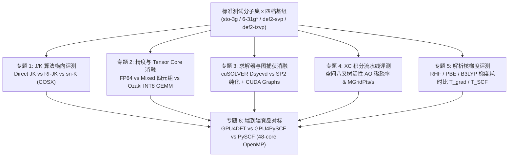

# GPU4DFT 数值精度验收与性能基准评测方案

> **配套架构规范**：[ARCHITECTURE.md](ARCHITECTURE.md)  
> **核心质量红线**：相对 `PySCF`（`libcint` + `Libxc`）全双精度参考值，单点自洽场（SCF）总能量误差严格满足 **$|E_{\text{GPU4DFT}} - E_{\text{PySCF}}| \le 10^{-10}\ E_\text{h}$**，并在 NVIDIA Blackwell / Hopper 及 AMD MI300 架构上系统量化各项硬件加速机制的端到端收益。

---

## 目录

1. [评测目标与标准软硬件基线规范](#1-评测目标与标准软硬件基线规范)
2. [标准评测分子体系与基组矩阵](#2-标准评测分子体系与基组矩阵)
3. [电子结构方法与泛函测试矩阵](#3-电子结构方法与泛函测试矩阵)
4. [分层数值精度验收准则（$\le 10^{-10}$ 门禁体系）](#4-分层数值精度验收准则le-10-10-门禁体系)
5. [六大核心性能消融与对标评测协议](#5-六大核心性能消融与对标评测协议)
   - [5.1 专题一：双电子 J/K 算法横向对比（Direct JK vs RI-JK vs sn-K/COSX）](#51-专题一双电子-jk-算法横向对比direct-jk-vs-ri-jk-vs-sn-kcosx)
   - [5.2 专题二：混合精度与 Ozaki INT8 Tensor Core 引擎消融评测](#52-专题二混合精度与-ozaki-int8-tensor-core-引擎消融评测)
   - [5.3 专题三：线性代数求解器与计算图对比（cuSOLVER Dsyevd vs SP2 纯化 + CUDA Graphs）](#53-专题三线性代数求解器与计算图对比cusolver-dsyevd-vs-sp2-纯化--cuda-graphs)
   - [5.4 专题四：XC 数值积分吞吐率与空间活性筛选效率](#54-专题四xc-数值积分吞吐率与空间活性筛选效率)
   - [5.5 专题五：解析核梯度精度与耗时比评测](#55-专题五解析核梯度精度与耗时比评测)
   - [5.6 专题六：相对 GPU4PySCF 与 CPU PySCF 的端到端对标指标体系](#56-专题六相对-gpu4pyscf-与-cpu-pyscf-的端到端对标指标体系)
6. [可复现计时规范与标准化报告 Schema](#6-可复现计时规范与标准化报告-schema)

---

## 1. 评测目标与标准软硬件基线规范

### 1.1 双重验证目标

1. **数学与物理正确性闭环（Correctness Gate）**：从底层特殊函数（Boys $F_m$、Rys 求积根）、单/双电子积分、符号自动微分泛函导数、Ozaki INT8 无误差矩阵乘法，直到完整的 RHF / RKS / 杂化泛函 SCF 能量与解析核梯度，逐层与 `PySCF` 建立自动化回归门禁，杜绝因低精度加速、筛选截断或原子累加导致的隐性精度退化。
2. **异构硬件屋脊线效能验证（Performance Gate）**：重点针对现代 GPU 原生 FP64 算力受限而 FP32 / INT8 Tensor Core 算力充沛的架构趋势，实测验证 GPU4DFT 五层架构在单算子吞吐（TFLOPS / MGridPts·s⁻¹）与端到端分子计算壁钟时间（Wall-Clock Time）上的加速比。

### 1.2 标准参考硬件与编译环境配置

| 配置项 | 主验证平台（Blackwell 架构） | 扩展对比平台（数据中心 GPU） | 构建与运行参数规范 |
| :--- | :--- | :--- | :--- |
| **GPU 硬件** | **NVIDIA RTX PRO 6000 Blackwell Server Edition** (`sm_120`, 188 SMs, 95 GiB GDDR7) | NVIDIA H100 SXM5 (80 GB) / A100 (80 GB) / AMD Instinct MI300X (192 GB) | 开启 Persistence Mode，记录实时功耗与 SM 时钟频率 |
| **CPU 与内存** | 48 核 AMD EPYC 9B45 处理器，177 GiB DDR5 RAM | 双路 EPYC / Xeon，512+ GiB RAM | CPU 对比实验固定 `OMP_NUM_THREADS=48` 并绑定 NUMA |
| **工具链** | CUDA Toolkit 13.0 (`nvcc` 13.0.88)、CMake 3.31.10、Ninja、GCC 13.3 (C++20) | CUDA 12.x/13.0 或 ROCm 6.2+ (`hipcc`) | `-DCMAKE_BUILD_TYPE=Release -DCMAKE_CUDA_ARCHITECTURES=native` |
| **参照软件栈** | Python 3.12、`pyscf 2.15+`、`gpu4pyscf-cuda13x 1.9+`、`cupy-cuda13x 14.2+` | 同左 | 统一关闭无关磁盘 I/O（`mol.max_memory = 64000`） |

---

## 2. 标准评测分子体系与基组矩阵

为全面覆盖不同空间维数（三维球状团簇 vs 一维稀疏长链 vs 稠密离域共轭环）与不同角动量极化深度，设定四大标准分子序列与四档标准高斯球谐基组（`mol.cart = False`）。

### 2.1 四档标准基组与角动量特征表

| 基组名称 | 收缩特征与最高角动量 $l_{\max}$ | 覆盖的关键积分通道 | 配对 RI 辅助拟合基组 | 主要评测目的 |
| :--- | :--- | :--- | :--- | :--- |
| **`sto-3g`** | 最小收缩基（H: $1s$；C/N/O: $2s1p$，$l_{\max}=1$，每壳 3 原函数） | `(ss\|ss)` 至 `(pp\|pp)`（纯 MD + J-Engine 通道） | `def2-svp-jkfit` | 验证深收缩低角动量壳与 `warp` 映射效率 |
| **`6-31g*`** | 劈裂价层极化基（重原子含深收缩 $6s$ 内壳与 $d$ 极化壳，$l_{\max}=2$） | `(ss\|ss)` 至 `(dd\|dd)`（MD 与 Rys 2D-VRR 混合路由） | `def2-svp-jkfit` | 有机化学高频实用基组，检验非均匀原函数收缩负载均衡 |
| **`def2-svp`** | Ahlrichs 双劈裂极化基（H 含 $p$，重原子含 $d$，$l_{\max}=2$） | 全套 $s,p,d$ 规范类 | `def2-universal-jkfit` | 中大型体系标准扫描基组，对标 GPU4PySCF 主力测试集 |
| **`def2-tzvp`** | Ahlrichs 三劈裂高极化基（重原子含 **$f$ 壳**，$l_{\max}=3$；辅助基含 **$g$ 壳**，$l_{\max}=4$） | 高角动量 `(fd\|dd)`、`(ff\|ff)` 及三中心 `(ff\|g)` | `def2-universal-jkfit` | 压力测试高角动量 Rys 寄存器控制、RI-JK 与 `sn-K` 交叉点 |

### 2.2 标准测试分子集规模矩阵

| 体系类别 | 分子标识 | 原子数 $N_{\text{atom}}$ | 电子数 $N_{\text{elec}}$ | `sto-3g` $N_{\text{AO}}$ | `6-31g*` $N_{\text{AO}}$ | `def2-svp` $N_{\text{AO}}$ | `def2-tzvp` $N_{\text{AO}}$ | 物理与算法检验重点 |
| :--- | :--- | ---: | ---: | ---: | ---: | ---: | ---: | :--- |
| **三维水团簇序列** | `(H2O)_2` | 6 | 20 | 14 | 38 | 48 | 86 | 微小体系基准、CUDA Graph 启动开销敏感度 |
| *(3D 球状氢键网络)* | `(H2O)_8` | 24 | 80 | 56 | 152 | 192 | 344 | 中小规模全矩阵精度门禁与核梯度有限差分 |
| | `(H2O)_16` | 48 | 160 | 112 | 304 | 384 | 688 | 三维稠密库仑耦合，RI-JK vs Direct JK 交叉点 |
| | `(H2O)_32` | 96 | 320 | 224 | 608 | 768 | 1,376 | 中大型团簇混合精度积分与 XC 空间八叉树吞吐 |
| | `(H2O)_64` | 192 | 640 | 448 | 1,216 | 1,536 | 2,752 | 大维度 Ozaki INT8 GEMM 与 SP2 纯化效率 |
| **准一维正构烷烃序列** | `C8H18` | 26 | 66 | 58 | 156 | 202 | 356 | 链状分子初始标度基点 |
| *(渐近稀疏标度测试)* | `C16H34` | 50 | 130 | 114 | 308 | 398 | 700 | Schwarz + 密度加权筛选早期裁剪率测量 |
| | `C32H66` | 98 | 258 | 226 | 612 | 790 | 1,388 | 验证增量 $\Delta\mathbf{F}(\Delta\mathbf{D})$ 与 XC 活性筛选的渐近 $O(N)$ 标度 |
| | `C64H130` | 194 | 514 | 450 | 1,220 | 1,574 | 2,764 | 长链绝缘体上 SP2 纯化的常数迭代步数特性 |
| **共轭芳烃与药物分子** | `C6H6` (苯) | 12 | 42 | 36 | 102 | 114 | 222 | 高对称离域 $\pi$ 电子体系 CDIIS 收敛稳定性 |
| *(稠密离域密度测试)* | `C9H8O4` (阿司匹林) | 21 | 94 | 73 | 211 | 226 | 451 | 含 C/H/O 极性官能团真实药物构象与核梯度基准 |
| | `C8H10N4O2` (咖啡因) | 24 | 102 | 80 | 230 | 250 | 496 | 含 C/H/N/O 杂环药物分子杂化 DFT 基准 |
| | `C60` (富勒烯) | 60 | 360 | 300 | 900 | 840 | 1,860 | 三维球壳强离域稠密密度矩阵（最严苛 K 筛选压力测试） |

---

## 3. 电子结构方法与泛函测试矩阵

所有基准体系在以下五个代表性方法层级上交叉评测，覆盖波函数理论与 Jacob 天梯第 1 至第 4 阶泛函：

| 方法代号 | 理论阶梯分类 | 精确 HF 交换比例 $\alpha_x$ | 密度依赖变量 | 检验的计算路径组合 |
| :--- | :--- | :---: | :--- | :--- |
| **`RHF`** | 限制性 Hartree–Fock | $1.00$ | $\mathbf{D}$ | `1e` + `DirectJK` / `RIJK` / `sn-K` + `DIIS` + `Diag`/`SP2` |
| **`LDA` (`svwn`)** | 第 1 阶：局域密度近似 (Slater + VWN5) | $0.00$ | $\rho(\mathbf{r})$ | `1e` + 纯库仑 `J` (Hermite J-Engine / RI-J) + `XC(LDA)` |
| **`PBE`** | 第 2 阶：广义梯度近似 (GGA) | $0.00$ | $\rho(\mathbf{r}), \sigma(\mathbf{r})=|\nabla\rho|^2$ | `1e` + 纯库仑 `J` + 一阶导数 AO 求值 + `XC(GGA)` |
| **`TPSS`** | 第 3 阶：含动能密度 Meta-GGA | $0.00$ | $\rho(\mathbf{r}), \sigma(\mathbf{r}), \tau(\mathbf{r})$ | `1e` + 纯库仑 `J` + $\tau$ 动能密度缩并 + `XC(MGGA)` |
| **`B3LYP`** | 第 4 阶：全局杂化 GGA (`0.20 HF + 0.08 Slater + 0.72 B88 + 0.81 LYP + 0.19 VWN-RPA`) | $0.20$ | $\mathbf{D}, \rho(\mathbf{r}), \sigma(\mathbf{r})$ | 全路径协同：`1e` + `J` + `0.20 K` + `XC(Hybrid GGA)` |

*(注：补充单元测试同时验证 `svwn_rpa`, `spz81`, `blyp`, `b3lyp5`, `pbe0` 与 `PySCF` `eval_xc` 的精确对齐。)*

---

## 4. 分层数值精度验收准则（$\le 10^{-10}$ 门禁体系）

为防止多层误差相互掩盖，评测采用**自底向上逐层锁死容差**的门禁机制。任何一层未达标即视为 CI 失败：

| 验证层级 | 被测算子 / 模块 | 对照真值来源 | 误差度量定义 | 硬性通过门禁（Pass Criteria） |
| :--- | :--- | :--- | :--- | :--- |
| **L0: 特殊函数** | `boys_vec<double>` ($m \le 24$) | 20000 点 `long double` Simpson / `mpmath` | $\max_{T, m} \frac{|F_m - F_m^{\text{ref}}|}{\max(F_m^{\text{ref}}, 10^{-30})}$ | **$\le 1.0 \times 10^{-14}$**（`float` $\le 2.0 \times 10^{-6}$） |
| **L0: 求积根** | `rys_roots_weights<double>` ($n_r \le 8$) | 精确 Boys 矩 $F_0 \dots F_{2n_r-1}$ | $\max_{0 \le k < 2n_r} \big|\sum_r w_r u_r^k - F_k(T)\big|$ | **$\le 1.0 \times 10^{-12}$** |
| **L1: 单电子积分** | `overlap_matrix`, `kinetic_matrix`, `nuclear_attraction_matrix` | `mol.intor('int1e_ovlp' / 'kin' / 'nuc')` | $\|\mathbf{M} - \mathbf{M}_{\text{PySCF}}\|_\infty$ | **$\le 1.0 \times 10^{-12}$** |
| **L1: 四阶 ERI** | `eri_tensor` ($s,p,d,f$ 全壳层, Host & CUDA) | `mol.intor('int2e', aosym='s1')` | $\frac{\|\mathcal{I} - \mathcal{I}_{\text{PySCF}}\|_\infty}{\|\mathcal{I}_{\text{PySCF}}\|_\infty}$ | **$\le 1.0 \times 10^{-12}$**（FP64）/ **$\le 5.0 \times 10^{-6}$**（FP32） |
| **L2: Direct J/K** | `DirectJKEngine::compute_jk` (`FP64` / `Mixed`) | `pyscf.scf.hf.get_jk(mol, dm)` | $\|\mathbf{J}-\mathbf{J}_{\text{ref}}\|_\infty,\; \|\mathbf{K}-\mathbf{K}_{\text{ref}}\|_\infty$ | `FP64`: **$\le 1.0 \times 10^{-11}$**；`Mixed` ($\tau_{\text{fp32}}=10^{-6}$): **$\le 1.0 \times 10^{-9}$**（对应双电子能偏差 **$\le 10^{-10}\ E_\text{h}$**） |
| **L2: RI-JK** | `RIJKEngine::compute_jk` | `pyscf.df.incore` / `df.JK`（同 `auxbasis`） | $\|\mathbf{J}_{\text{RI}} - \mathbf{J}_{\text{PySCF-DF}}\|_\infty,\; \|\mathbf{K}_{\text{RI}} - \mathbf{K}_{\text{PySCF-DF}}\|_\infty$ | 同辅助基组算法一致性 **$\le 1.0 \times 10^{-11}$**（另单独记录相对解析 4c-JK 的物理 DF 偏差，典型 $< 50\ \mu E_\text{h}/\text{atom}$） |
| **L2: 半数值 sn-K** | `SemiNumericalK::compute_k` (COSX) | Host 参考实现 & 解析 $\mathbf{K}$（随格点加密收敛） | Host/CUDA 一致性及精细格点下相对解析 $\mathbf{K}$ 能量差 | Host vs CUDA **$\le 1.0 \times 10^{-12}$**；精细格点重叠拟合后 RHF/B3LYP 能量偏差 $< 10^{-4}\ E_\text{h}$ |
| **L3: 符号 XC 核** | `xc_codegen` 生成核 (`lda`, `pbe`, `b3lyp`, `tpss`) | `pyscf.dft.libxc.eval_xc` | 逐格点 $\max |\epsilon_{\text{xc}} - \epsilon_{\text{ref}}|,\; |v - v_{\text{ref}}|$ | **$\le 1.0 \times 10^{-12}$**（涵盖一阶导与二阶导） |
| **L3: XC 矩阵积分** | `XcEngine::eval_vxc`（注入 `PySCF` 同格点） | `pyscf.dft.numint.nr_rks` | $|E_{\text{xc}} - E_{\text{xc}}^{\text{ref}}|,\; \|\mathbf{V}_{\text{xc}} - \mathbf{V}_{\text{xc}}^{\text{ref}}\|_\infty$ | $|E_{\text{xc}}|$ 误差 **$\le 1.0 \times 10^{-11}\ E_\text{h}$**，$\|\Delta\mathbf{V}_{\text{xc}}\|_\infty \le 1.0 \times 10^{-10}$ |
| **L4: Ozaki GEMM** | `gemm(..., GemmMode::OzakiInt8)` | 原生 `cublasDgemm` (`FP64`) | $\frac{\|\mathbf{C}_{\text{Ozaki}} - \mathbf{C}_{\text{FP64}}\|_{\text{F}}}{\|\mathbf{C}_{\text{FP64}}\|_{\text{F}}}$ | **$\le 1.0 \times 10^{-13}$**（含非 16 倍数任意素数维度 $N_{\text{AO}}$） |
| **L4: SP2 纯化** | `solve_fock_sp2` (`FP64` / `OzakiInt8`) | `solve_fock_diag` (`cusolverDnDsyevd`) | $\|\mathbf{D}_{\text{SP2}} - \mathbf{D}_{\text{Diag}}\|_{\text{F}},\; |\mathrm{Tr}(\mathbf{D}\mathbf{F})|$ | 有能隙体系密度矩阵误差 **$\le 1.0 \times 10^{-11}$**，电子能量差 **$\le 1.0 \times 10^{-10}\ E_\text{h}$** |
| **L5: 端到端 SCF** | `ScfDriver::run` (`RHF`, `LDA`, `PBE`, `B3LYP`, `TPSS`) | `PySCF` `RHF` / `RKS` (`conv_tol=1e-11`) | $|E_{\text{tot}}^{\text{GPU4DFT}} - E_{\text{tot}}^{\text{PySCF}}|$ | **$\le 1.0 \times 10^{-10}\ E_\text{h}$**（同格点下；含动态混合精度 + 增量 Fock 重置路径） |
| **L6: 解析核梯度** | `1e_grad + jk_grad + xc_grad + nuc_grad` | `PySCF` `Gradients()` 及五点中心有限差分 ($h=10^{-4}\ a_0$) | $\max_{A, \xi} |g_{A\xi} - g_{A\xi}^{\text{ref}}|$ | 对照同配置 `PySCF` **$\le 1.0 \times 10^{-8}\ E_\text{h}/a_0$**；对照有限差分 **$\le 1.0 \times 10^{-7}\ E_\text{h}/a_0$** |

---

## 5. 六大核心性能消融与对标评测协议



### 5.1 专题一：双电子 J/K 算法横向对比（Direct JK vs RI-JK vs sn-K/COSX）

- **实验控制变量**：在 `(H2O)_2` $\to$ `(H2O)_64` 及阿司匹林/咖啡因上，固定收敛密度矩阵 $\mathbf{D}$，分别运行 `DirectJKEngine`、`RIJKEngine`（配对 `def2-universal-jkfit`）与 `SemiNumericalK`（配对中/精两档分子格点），跨越 `sto-3g`, `6-31g*`, `def2-svp`, `def2-tzvp`。
- **采集指标**：
  1. 预处理耗时 $T_{\text{init}}$（壳对与 Schwarz 构造 vs 二/三中心积分及 $\mathbf{L}^{-1}$ 三角解 vs 格点静电势预表）；
  2. 单步收缩耗时 $T_{\text{step}}$（区分纯 $\mathbf{J}$ 模式与 $\mathbf{J}+\mathbf{K}$ 杂化模式）；
  3. 峰值显存占用 $\text{VRAM}_{\text{peak}}$（量化 Direct JK 的 $O(N^2)$ 零张量显存优势与 RI-JK 的 $O(N_{\text{aux}} N^2)$ 显存曲线）；
  4. **算法性能交叉点（Crossover Point）**：测定在 `def2-tzvp`（含 $f$ 壳）与 `def2-svp` 下，RI-JK 与 `sn-K` 相对解析四中心 Direct JK 获得 $2\times$、$5\times$、$10\times$ 加速的临界 $N_{\text{AO}}$，以及大尺寸体系下 $O(N_{\text{grid}}N^2)$ 的 `sn-K` 反超 $O(N_{\text{aux}}N_{\text{occ}}N^2)$ RI-K 的交点。

### 5.2 专题二：混合精度与 Ozaki INT8 Tensor Core 引擎消融评测

本专题专门针对 **NVIDIA Blackwell** 等受限原生 FP64 架构验证核心创新收益：

1. **矩阵乘法微基准（GEMM Micro-Benchmark）**：  
   在维度 $N \in \{256, 512, 1024, 2048, 4096, 8192, 12288\}$（并附加非对齐维度如 $N = 1003, 2753$ 验证自动 16-Padding 开销）的随机条件数与真实分子 Fock/正交化矩阵上，对比三种 `GemmMode`：
   - `GemmMode::FP64`（`cublasDgemm`）；
   - `GemmMode::OzakiInt8`（$S = 8$ 切片 INT8 Tensor Core `cublasGemmEx`）；
   - `GemmMode::FP32`（`cublasSgemm`）。  
   记录：**有效双精度等效吞吐 $\text{TFLOPS}_{\text{eff}} = \frac{2N^3}{T_{\text{wall}} \times 10^{12}}$**、相对 `FP64` 加速比，以及相对 `cublasDgemm` 的最大元误差与 Frobenius 相对误差。
2. **动态混合精度积分与多阶段 SCF 消融**：  
   在 `(H2O)_16`、`C32H66`、`C60`（`6-31g*` 与 `def2-svp`）上对比四组 SCF 配置：
   - **Baseline-A**：全量 Fock + 纯 `FP64` 积分 + `FP64` GEMM；
   - **Ablation-B**：启用增量 Fock $\Delta\mathbf{F}(\Delta\mathbf{D})$ + 纯 `FP64` 积分；
   - **Ablation-C**：增量 Fock + `Precision::Mixed` 动态四元组分派（扫描 $\tau_{\text{fp32}} \in \{10^{-5}, 10^{-6}, 10^{-7}\}$）；
   - **Full-D**：增量 Fock + 多阶段精度调度（前段 `Mixed` + 终局 `FP64` 重置）+ `OzakiInt8` GEMM。  
   记录每步 SCF 落入 `FP64` / `FP32` / `Screened` 三区的壳四元组百分比、累计壁钟时间加速比，并确认最终收敛能量与 Baseline-A 偏差 **$\le 10^{-10}\ E_\text{h}$**。

### 5.3 专题三：线性代数求解器与计算图对比（cuSOLVER Dsyevd vs SP2 纯化 + CUDA Graphs）

- **实验矩阵**：在 `C16H34` $\to$ `C64H130`、`(H2O)_16` $\to$ `(H2O)_64` 及合成扩展块矩阵（$N_{\text{AO}} = 500 \dots 12,000$）上对比：
  1. `solve_fock_diag`（`cusolverDnDsyevd` + `FP64` / `OzakiInt8` 变换）；
  2. `solve_fock_sp2`（分别搭配 `GemmMode::FP64`、`GemmMode::OzakiInt8`、以及混合前段 `FP32` + 末两步 `OzakiInt8` McWeeny 抛光）；
  3. 开关 `use_cuda_graphs = false` vs `use_cuda_graphs = true`。
- **采集指标**：单次密度矩阵求解耗时（ms）、SP2 多项式迭代步数 $K_{\text{SP2}}$、幂等性残差 $\|\mathbf{P} - \mathbf{P}^2\|_{\text{F}}$、SP2 超越 `cusolverDnDsyevd` 的临界矩阵维度 $N_{\text{cross}}$，以及在小中体系（$N_{\text{AO}} < 500$）上 `CudaGraphExecutor` 消除内核启动气泡带来的迭代延迟降幅（%）。

### 5.4 专题四：XC 数值积分吞吐率与空间活性筛选效率

- **实验矩阵**：固定 `(H2O)_8` $\to$ `(H2O)_64` 与 `C8H18` $\to$ `C64H130`（`def2-svp` / `def2-tzvp`），测试 `LDA`、`PBE`、`TPSS` 三档泛函及 `(50, 194)`、`(75, 302)`、`(99, 590)` 三档径向/球面格点密度。
- **采集指标**：
  1. GPU 分子格点生成与 SSF 剖分耗时 $T_{\text{grid}}$（ms）；
  2. 空间八叉树块平均活性 AO 占比 $\bar{\eta}_{\text{act}} = \frac{1}{N_{\text{block}}}\sum_B \frac{|\mathcal{A}_B|}{N_{\text{AO}}}$（验证长链烷烃随长度增加 $\bar{\eta}_{\text{act}} \propto N^{-1}$ 趋于零）；
  3. 有效格点积分吞吐率（**$\text{MGridPts/s} = \frac{N_{\text{grid}}}{T_{\text{vxc}} \times 10^6}$**）及算子时间占比（AO 求值 vs 批量 GEMM vs 符号泛函核）。

### 5.5 专题五：解析核梯度精度与耗时比评测

- **实验矩阵**：在 `(H2O)_8`、`C6H6`、`C9H8O4`（阿司匹林）与 `C16H34` 上运行 `RHF`、`PBE`、`B3LYP`（`6-31g*` 与 `def2-svp`）全收敛 SCF 后紧接解析核梯度计算。
- **采集指标**：
  1. 分项梯度耗时：$T_{\text{grad,1e}}$（含重叠矩阵 Pulay 项 $-\mathrm{Tr}(\mathbf{W}\nabla\mathbf{S})$）、$T_{\text{grad,2e}}$、$T_{\text{grad,xc}}$；
  2. **梯度相对单次 SCF 耗时比 $\gamma_{\text{grad}} = \frac{T_{\text{grad,total}}}{T_{\text{SCF,total}}}$**（目标 $\gamma_{\text{grad}} < 0.35$，显著快于一次完整 SCF 过程）；
  3. 分子净平移力与净力矩零和检验：$\left|\sum_A \mathbf{g}_A\right|_\infty \le 10^{-11}\ E_\text{h}/a_0$。

### 5.6 专题六：相对 GPU4PySCF 与 CPU PySCF 的端到端对标指标体系

为确保与业界标杆 `GPU4PySCF` 和多核 CPU `PySCF` 的对标客观公正，必须强制锁定相同的物理与数值控制参数：

#### 公平对标参数对齐表（Apple-to-Apple Alignment）

| 对齐维度 | GPU4DFT 配置 | GPU4PySCF / PySCF 配置 | 对齐说明 |
| :--- | :--- | :--- | :--- |
| **基组与球谐约定** | `basis_from_pyscf(mol)` (`mol.cart = False`) | `mol.cart = False` | 相同的 $N_{\text{AO}}$ 与实固体球谐归一化 |
| **正交化线性相关阈值** | `lindep_tol = 1e-7` | `scf.addons.remove_linear_dep_` (`1e-7`) | 相同的有效分子轨道维数 $N_{\text{mo}}$ |
| **双电子积分截断** | `schwarz_cutoff = 1e-12` | `mf.direct_scf_tol = 1e-12` | 相同的 Cauchy–Schwarz 渐近筛选精度 |
| **XC 数值积分格点** | 注入相同 `(coords, weights)` 或同阶 `(75, 302)` M4+SSF | `mf.grids.atom_grid = (75, 302)` (`radi_method=treutler`, `becke_scheme=stratmann`) | 严格对齐总格点数 $N_{\text{grid}}$ |
| **SCF 收敛判据** | `conv_tol = 1e-9`, `diis_max_vec = 8` | `mf.conv_tol = 1e-9`, `mf.diis_space = 8` | 相同的能量收敛深度与 Pulay 子空间容量 |
| **初猜密度矩阵** | 统一传入 `mf.get_init_guess(mol, 'minao')`（或核心哈密顿初猜） | `mf.init_guess = 'minao'` | 消除初猜差异导致的迭代步数偏差，直接对比每步纯引擎速度与总时间 |

#### 核心对标输出指标

对每个 `(体系, 基组, 方法)` 组合，统一汇总：
- **收敛步数** $N_{\text{iter}}$ 与**总能量差** $\Delta E = |E_{\text{GPU4DFT}} - E_{\text{PySCF}}|$（$E_\text{h}$）；
- **初始化耗时** $T_{\text{setup}}$（s）：壳对/辅助积分/分子格点/正交化预处理；
- **SCF 纯迭代总耗时** $T_{\text{scf}}$（s）与**单步平均耗时** $T_{\text{per\_iter}} = T_{\text{scf}} / N_{\text{iter}}$（ms）；
- **端到端总耗时** $T_{\text{e2e}} = T_{\text{setup}} + T_{\text{scf}}$（s）及相对 CPU PySCF（48 核）加速比 $S_{\text{CPU}}$、相对 GPU4PySCF 加速比 $S_{\text{GPU4PySCF}}$；
- **解析核梯度耗时** $T_{\text{grad}}$（s）与最大力偏差 $\|\Delta \mathbf{g}\|_\infty$（$E_\text{h}/a_0$）；
- **GPU 峰值显存占用** $\text{VRAM}_{\text{peak}}$（MiB）。

---

## 6. 可复现计时规范与标准化报告 Schema

### 6.1 严谨 GPU 计时准则

1. **CUDA 上下文与 JIT 预热隔离**：任何计时循环开始前，必须先用小分子（如 `H2O/6-31g*`）执行一次完整的预热运行（Warm-up Run）并调用 `cudaDeviceSynchronize()`，排除驱动初始化、cuBLAS/cuSOLVER 句柄加载与 PTX JIT 编译开销。
2. **设备异步事件与壁钟双轨记录**：
   - 子算子微观耗时使用配对 `cudaEventRecord(start, stream)` / `cudaEventRecord(stop, stream)` + `cudaEventElapsedTime` 精确测量纯 GPU 流执行时间；
   - 端到端对比统一在起止点显式同步（`cudaDeviceSynchronize()` / `cupy.cuda.Stream.null.synchronize()`），采用单调高精度时钟 `std::chrono::steady_clock` / `time.perf_counter()`。
3. **多轮统计稳健性**：每个基准测试点连续独立运行 $R = 5$ 次（微基准 $R = 20$ 次），报告**中位数（Median）**与**四分位距（IQR / P95）**，若变异系数 $\text{CV} > 5\%$ 自动标记环境噪声告警。

### 6.2 自动化回归 JSON 记录格式

所有基准运行结果统一输出为结构化 JSON 文件（供 CI 绘制历史趋势与回归检测）：

```json
{
  "metadata": {
    "git_revision": "main",
    "gpu_name": "NVIDIA RTX PRO 6000 Blackwell Server Edition",
    "vram_total_mib": 98304,
    "cuda_version": "13.0",
    "cpu_model": "AMD EPYC (48 vCPU)",
    "timestamp_utc": "2026-11-17T12:00:00Z"
  },
  "benchmarks": [
    {
      "system": "(H2O)_16",
      "basis": "def2-svp",
      "nao": 384,
      "nelec": 160,
      "method": "B3LYP",
      "jk_mode": "DirectJK_Mixed",
      "gemm_mode": "OzakiInt8",
      "solver": "Diag_CudaGraph",
      "converged": true,
      "iterations": 11,
      "energy_hartree": -1222.184930284112,
      "abs_diff_vs_pyscf_eh": 1.8e-11,
      "max_grad_diff_eh_bohr": 4.2e-10,
      "time_setup_s": 0.042,
      "time_scf_s": 0.198,
      "time_per_iter_ms": 18.0,
      "time_grad_s": 0.061,
      "peak_vram_mib": 312.5,
      "speedup_vs_pyscf_cpu48": 38.4,
      "speedup_vs_gpu4pyscf": 1.45
    }
  ]
}
```
